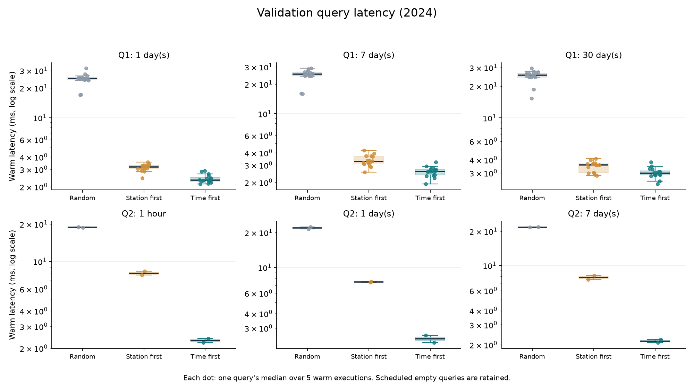
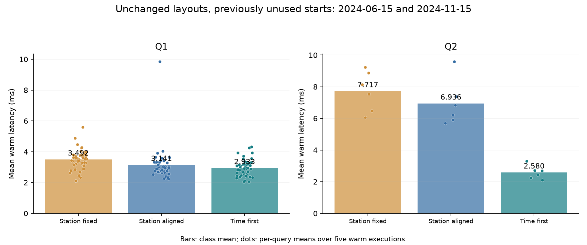

# 大作业ai对话记录

整理日期：2026 年 11 月 15 日（香港时间）。

课题：浮标时序 Parquet 布局中站点边界对齐的效益与代价。

仓库：https://github.com/wzyonepp/ocean-data-mining

**文件性质：这是研究完成后，根据用户确认的 14 项提纲集中编写的补充问答。** 各节“指令”来自已确认的清单，“回答”根据已有代码、资料和实验结果整理，并非按时间逐轮发生的历史聊天。本次整理没有重新下载数据、执行性能实验或补造个人决策。代码块为实现逻辑摘录或说明示例，复现命令供另行执行；此前运行的证据通过链接提供。

仓库当前保留这份按提纲整理的补充问答。它不包含完整历史聊天过程，也不恢复用户指定排除的讨论。

仓库结构更新说明（2026 年 11 月 18 日）：最终课程报告单独提交。以下 14 项指令与回答主体保留，材料链接和分析命令按当前仓库入口更新；本次更新没有重新运行实验。

## 1. 确定研究问题

> [!IMPORTANT]
> **指令：**
>
> **结合第二章的内容，我想研究浮标时序数据的 Parquet 排序方式。帮我把题目缩小，明确研究问题和范围。**

**回答：**

可以从第二章的“列式布局、排序和行组跳过”切入，先研究一个具体问题：**同一份浮标观测数据按“站点、时间”或“时间、站点”排序，在单站点查询和跨站点时间查询中有什么差别？**

这里比较文件内部的记录顺序，先固定文件数量、分区方式、压缩设置、编码和行组行数上限。研究对象是查询性能，不包括海温预测、海洋环流模拟或建设完整湖仓平台。

后续扩展问题来自已有实验的诊断：按站点排序之后，固定行数分组仍可能把两个站点放进同一行组。因此进一步研究：**保持站点优先行序，让新站点从新的行组开始，能否减少实际没有匹配记录的候选行组，并改善查询耗时？**

初始排序对照和后续边界对齐分为两个阶段。后者允许行组数量变化，不能混进“只改变排序”的初始实验中。

对应材料：[研究问题与边界](../report/01_research_scope.md)、[正式实验与诊断结果](../report/07_formal_results.md)、[边界对齐方案](../report/08_alignment_protocol.md)。

## 2. 了解相关技术

> [!IMPORTANT]
> **指令：**
>
> **解释这个课题涉及的关键原理，查找相关资料和技术进展，说明有哪些值得实验验证的问题，并提供来源。**

**回答：**

Parquet 按行组组织数据，每个行组内部按列存储。文件元数据中可以保存各列的最小值和最大值。查询某个时间范围时，如果某组的时间范围完全不相交，就可以排除该组；按时间排序通常会使每组的时间范围更集中。

但“范围相交”只表示暂时不能排除，不保证组内存在匹配记录。尤其同时筛选站点和时间时，逐列范围没有保存“哪个站点对应哪个时间”的完整关系。这是本实验需要检查的机制。

与课题直接相关的资料如下，均来自仓库此前的调研记录，本次未新增文献检索：

| 资料 | 对实验的作用 |
|---|---|
| [Apache Parquet 文件格式](https://parquet.apache.org/docs/file-format/) | 理解行组、列块与文件尾部元数据 |
| [DuckDB 读取 Parquet](https://duckdb.org/docs/2.0/data/parquet/overview) | 理解只读所需列、筛选下推和直接扫描文件 |
| [DuckDB Parquet Tips](https://duckdb.org/docs/2.0/data/parquet/tips) | 理解排序、行组大小和跳过效果的取舍 |
| [PyArrow write_table](https://arrow.apache.org/docs/python/generated/pyarrow.parquet.write_table.html) | 明确写入参数；`sorting_columns` 本身不会重排记录 |
| [Qd-tree，SIGMOD 2020](https://doi.org/10.1145/3318464.3389770) | 说明根据查询需求组织数据布局已有研究 |
| [Data formats in analytical DBMSs，2025](https://doi.org/10.1007/s00778-025-00911-1) | 了解编码、解码、缓存和执行路径共同影响性能的讨论 |

相关研究从简单排序，发展到根据查询需求设计数据块，并进一步关注文件格式与执行引擎的配合。这些资料不构成截至整理日期的全部最新研究，也不足以证明本方案首创。

值得验证的问题是：候选行组减少，是否一定意味着查询更快？压缩文件大小、解码和查询本身的开销，是否会改变排序的实际效果？

对应材料：[资料调研记录](../report/02_literature_review.md)。

## 3. 制定实验方案

> [!IMPORTANT]
> **指令：**
>
> **设计一个能量化比较不同排序方式的实验方案，说明对照方案、查询类型、评价指标，以及需要固定的条件。**

**回答：**

初始实验使用同一份清洗后的数据，生成随机、站点优先和时间优先三种布局。随机布局作为没有有序聚集的参照，两种有序布局用于主要比较。

| 项目 | 采用的设计 |
|---|---|
| Q1 | 指定一个站点，查询 1、7、30 天 |
| Q2 | 不限制站点，查询 1 小时、1、7 天 |
| 返回结果 | 匹配记录数和平均水温 |
| 文件组织 | 每种布局一个文件，不进行目录分区 |
| 写入设置 | ZSTD 级别 3，仅站点列字典编码，开启行组统计，关闭页索引 |
| 行组行数上限 | 16,384 行 |
| 运行条件 | 单查询线程、UTC、预热后的查询 |
| 重复方法 | 每条查询在每种布局上额外预热一次，再计时五次；打乱查询顺序并轮换布局顺序 |

主要指标是查询耗时：先对每条查询五次计时求平均，再对同类查询取等权平均。另观察单条查询分布、候选行组、实际含匹配记录的行组、文件大小和文件尾部元数据大小。

查询窗口包含起点、不包含终点。预先选定的空结果查询也保留，另检查排除空结果后结论是否一致。候选行组数是根据元数据推算的指标，不等于 DuckDB 实际读取量。

对应材料：[实验方案](../report/04_experiment_protocol.md)、[固定配置](../config/pilot_v1.json)。

## 4. 准备真实数据和处理代码

> [!IMPORTANT]
> **指令：**
>
> **寻找适合实验的公开浮标数据，生成下载、清洗和检查代码，说明数据来源及处理方法。**

**回答：**

项目使用 NOAA ERDDAP 的 [cwwcNDBCMet 数据集说明](https://upwell.pfeg.noaa.gov/erddap/info/cwwcNDBCMet/index.html)。它对 NDBC 数据进行过标准化、重整和少量编辑，不能称为完全未经处理的原始观测。

数据覆盖 41001、41002、41004、41008、41009、41010、41013、41025 共 8 个站点，分别取得 2023、2024 年的 `station,time,WTMP`，共 16 个 CSV。

处理结果是：734,800 条输入记录，剔除 20,977 条缺测水温后保留 713,823 条有效记录，没有站点与时间组合重复的记录。不插值，也不复制数据扩大规模。字段统一为字符串站点编号、UTC 微秒时间戳和 float64 水温。

完整下载与筛查实现见 [screen_ndbc_data.py](../code/screen_ndbc_data.py)，清洗和基表构造见 [run_parquet_pilot.py 的 read_base](../code/run_parquet_pilot.py)。其中核心过滤规则是：

```python
import math

def valid_temperature(text_value):
    value = float(text_value)
    if not math.isfinite(value) or value == -9999999.0:
        return None
    return value
```

这段示例只说明水温过滤；完整实现还检查文件 SHA-256、字段名、单位、站点和记录数量。

复现已保存结果时，使用恢复工具，而不是重新筛查并覆盖原始清单：

```bash
python -m pip install -r requirements-formal.txt
python code/restore_parquet_inputs.py
```

恢复工具会校验输入；上游历史数据如果已经变化，工具会报错，不会直接用不同数据替换原实验快照。逐文件来源和校验值见 [数据清单](../results/data_screening_manifest.json)。

## 5. 生成不同布局的数据文件

> [!IMPORTANT]
> **指令：**
>
> **生成随机、站点优先、时间优先三种 Parquet 布局的代码，统一其他设置，并检查三种文件的数据内容是否一致。**

**回答：**

三种布局必须先实际重排记录，再写文件。仅填写排序描述元数据不会实现排序。

下面展示核心顺序构造逻辑，`base` 表示已经清洗好的 Arrow 表：

```python
import random
import pyarrow as pa

def make_layouts(base, seed=20261115):
    indices = list(range(base.num_rows))
    random.Random(seed).shuffle(indices)
    return {
        "random": base.take(pa.array(indices, type=pa.uint32())),
        "station_first": base.sort_by([
            ("station_id", "ascending"),
            ("observation_time", "ascending"),
        ]),
        "time_first": base.sort_by([
            ("observation_time", "ascending"),
            ("station_id", "ascending"),
        ]),
    }
```

完整写入、逐文件读回和校验在 [run_parquet_pilot.py](../code/run_parquet_pilot.py) 中。它读取同一份写入配置，并把三个文件读回、按相同规则排序、计算数据内容校验值，以确认记录集合相同。字节校验值可以不同，因为排列和压缩后的文件本来就不同。

此前实际生成的三种布局都包含 713,823 条记录、44 个行组。文件分别为随机 5,485,899 字节、站点优先 2,679,571 字节、时间优先 875,334 字节。即使压缩参数相同，记录顺序也会影响压缩效果。

对应证据：[布局清单](../results/pilot_v1/layout_manifest.json)、[预跑完整性检查](../results/pilot_v1/artifact_verification.json)。

## 6. 先跑通小规模实验

> [!IMPORTANT]
> **指令：**
>
> **生成查询和计时代码，先运行少量查询，检查结果正确性和测量方法。发现问题后先修正，再进行正式实验。**

**回答：**

小规模实验先回答“查得对不对、计时是否可比较、文件是否真的有多个行组”，暂不据此下正式性能结论。

Q1 的查询形式是：

```sql
SELECT count(*), avg(sst)
FROM read_parquet(?)
WHERE observation_time >= ?
  AND observation_time < ?
  AND station_id = ?;
```

Q2 去掉站点条件。用相同清洗基表计算参考结果，记录数必须一致；平均水温使用绝对误差 1e-9 或相对误差 1e-12 的容差核对。没有匹配记录时，COUNT 为 0，AVG 为 NULL，也要一致。

单次计时的核心逻辑如下；完整脚本另外负责预热、重复、交错顺序和结果校验：

```python
import time

def timed_query(connection, sql, parameters):
    start = time.perf_counter_ns()
    result = connection.execute(sql, parameters).fetchone()
    elapsed_ms = (time.perf_counter_ns() - start) / 1e6
    return result, elapsed_ms
```

此前预跑已经完成：12 条查询、3 种布局、36 次正确性检查、36 次额外预热和 180 次计时，检查全部通过。正确性检查和完整读回已经预热缓存，因此计时包含查询执行及结果获取，但不代表首次从磁盘读取的性能。

复现命令在恢复输入后执行，运行 ID 必须此前未使用：

```bash
python code/run_parquet_pilot.py --run-id qa_pilot_replication
```

对应材料：[预跑结果](../report/05_pilot_findings.md)、[原始计时](../results/pilot_v1/measurements.csv)。本次编写问答没有再次执行该命令。

## 7. 执行正式实验

> [!IMPORTANT]
> **指令：**
>
> **根据确定的方案运行正式实验，保存每次查询的耗时、正确性检查和运行条件，便于后续分析。**

**回答：**

正式实验使用 108 条预留查询，分成 54 条调整查询和 54 条验证查询。每部分包含 48 条 Q1 和 6 条 Q2，避免使用同一批结果既选择方案又评价方案。

- 调整起始日：2023-02-01、2023-08-01。
- 验证起始日：2024-02-01、2024-08-01。
- 先用调整集选择布局，并保存选择结果，再开始验证集计时。

此前正式运行保存了 324 次答案检查、324 次额外预热和 1,620 次计时，全部检查通过。测量文件包含查询编号、类别、布局、重复轮次、执行顺序、耗时和结果；协议保存环境版本、参数与代码校验值。

正式实验脚本和分析脚本分开，分析已有结果不需要重新执行查询：

```bash
# 以下为另行复现的命令，使用此前未使用的运行 ID。
python code/restore_parquet_inputs.py
python code/run_parquet_formal.py --run-id qa_formal_replication
python code/analyze_parquet_formal.py --run-dir results/qa_formal_replication
```

实际保存的原始运行仍为 [formal_v1](../results/formal_v1/README.md)，包括 [逐次计时](../results/formal_v1/measurements.csv)、[运行协议](../results/formal_v1/protocol.json)和[完整性检查](../results/formal_v1/artifact_verification.json)。

## 8. 分析初步结果

> [!IMPORTANT]
> **指令：**
>
> **分析实验数据并生成图表，说明不同排序分别适合哪些查询。结果是否支持我们的研究目标？有哪些现象需要进一步解释？**

**回答：**

原正式实验验证集的类别平均耗时如下，单位为毫秒：

| 类型 | 随机 | 站点优先 | 时间优先 |
|---|---:|---:|---:|
| Q1 | 27.187 | 4.261 | 2.986 |
| Q2 | 24.388 | 8.699 | 2.453 |

时间优先在这两类查询中的平均耗时都更低。仅根据调整集构造的选择规则，在全部 11 个查询比例上都选择时间优先，没有比始终使用时间优先进一步改进。比例曲线是对已有计时加权计算，并非额外执行了 11 套独立混合查询实验。

下面的分析示例只读取已保存 CSV，不执行 SQL；它先求每条查询的五次计时均值，再求类别均值：

```python
import csv
import statistics
from collections import defaultdict
from pathlib import Path

path = Path("results/formal_v1/measurements.csv")
per_query = defaultdict(list)
with path.open(encoding="utf-8", newline="") as stream:
    for row in csv.DictReader(stream):
        if row["phase"] == "measured" and row["role"] == "validation":
            key = (row["kind"], row["layout"], row["query_id"])
            per_query[key].append(float(row["elapsed_ms"]))

per_class = defaultdict(list)
for (kind, layout, query_id), values in per_query.items():
    assert len(values) == 5
    per_class[(kind, layout)].append(statistics.mean(values))
for key, values in sorted(per_class.items()):
    print(key, round(statistics.mean(values), 3))
```

完整分析与作图实现见 [analyze_parquet_formal.py](../code/analyze_parquet_formal.py)，已有图表包括耗时分布、查询比例与布局选择、候选行组、文件大小与边界统计。



这说明不能把“指定站点，所以站点优先一定更快”当成结论。值得继续解释的是：为什么站点排序后仍有多个没有实际匹配记录的候选行组？耗时差异中又有多少与压缩体积有关？

对应材料：[正式实验结果](../report/07_formal_results.md)、[分析汇总](../results/formal_v1/analysis_summary.json)。

## 9. 定位具体问题

> [!IMPORTANT]
> **指令：**
>
> **进一步检查站点优先布局，分析为什么部分查询仍然需要保留无关行组。编写诊断代码，用实际数据验证原因。**

**回答：**

诊断分两步：先从元数据推算哪些行组不能排除，再用 Arrow 单独读取这些组，计算实际匹配行数。完整实现见 [run_parquet_formal.py 的 diagnose_groups](../code/run_parquet_formal.py)，基本范围判断由 [run_parquet_pilot.py](../code/run_parquet_pilot.py) 提供。

真实例子是 41002 站点，查询 `[2023-03-15, 2023-03-16)`。原站点优先布局有以下三个候选组，组编号从 0 开始：

| 行组 | 站点范围 | 时间范围（日期） | 实际匹配记录数 |
|---|---|---|---:|
| 4 | 41001—41002 | 2023-01-01 至 2024-09-20 | 0 |
| 5 | 41002—41002 | 2023-03-05 至 2023-06-27 | 144 |
| 10 | 41002—41004 | 2023-01-01 至 2024-12-30 | 0 |

第 4、10 号组跨越站点边界。前一个站点的后期数据和后一个站点的早期数据被放入同一组，可能形成很宽的时间范围。站点范围包含 41002、时间范围包含目标日期，却没有同一条记录同时满足两个条件。

原正式实验的非空验证 Q1 中，原站点优先每条查询平均有 1.714 个候选行组实际没有匹配记录。这为改动提供了具体依据，但仍不能据此声称 DuckDB 实际读取了这些组，因为没有做引擎实际读取量跟踪。

对应证据：[真实样例诊断](../results/pilot_v1/boundary_diagnostic.json)、[正式逐组诊断](../results/formal_v1/joint_match_diagnostic.csv)。

## 10. 提出并比较改进方案

> [!IMPORTANT]
> **指令：**
>
> **针对发现的问题，提出几种可实现的改进思路，比较它们的原理、实现难度和可能代价，重点讨论站点边界对齐是否值得尝试。**

**回答：**

可以从以下几个方向考虑。表中的难度和潜在代价是设计判断，不是全部经过实验测量的结论。

| 思路 | 可能的作用 | 实现与代价 | 本项目处理方式 |
|---|---|---|---|
| 站点边界对齐 | 避免行组混合两个站点，使站点范围更准确 | 对已有写入过程改动较小，但会增加短行组和元数据 | 实际实现并验证 |
| 缩小所有行组 | 缩小每组的统计范围 | 会改变所有行组的粒度，增加组数和管理开销 | 未纳入本次比较 |
| 按站点目录分区 | 利用目录组织排除其他站点的数据 | 改变文件组织，可能增加小文件与维护工作 | 未纳入本次比较 |
| 改用时间优先 | 让短时间窗口覆盖的数据更集中 | 需要重排行序，不能单独解释站点边界问题 | 保留为实际测量的较强对照 |

边界对齐值得验证，是因为它针对已经检查到的混合站点行组，同时保持站点优先的记录顺序，便于解释分组规则的变化。研究价值不依赖它一定超过时间优先，而在于能否证明相对原站点优先的改进，以及明确代价。

按实体聚集和调整分组边界并非本项目首创。本项目新增的是具体浮标数据中的问题诊断、实现与对照验证；没有穷尽比较所有相近文献。

对应材料：[扩展方案](../report/08_alignment_protocol.md)。

## 11. 实现边界对齐

> [!IMPORTANT]
> **指令：**
>
> **生成站点边界对齐的实现代码，说明它相对原方案具体改了什么，并检查数据、行序和查询结果是否保持一致。**

**回答：**

原方案对全表每 16,384 行切一组，不考虑站点变化。边界对齐仍按“站点、时间”排列，但对每个站点分别切组：不足上限的尾部单独写出，下一个站点不拼入该尾组。所有站点仍写进同一个文件，不建立站点目录分区。

下面是与已有实现相同的核心写入方式，参数 `station_sorted` 是已按站点、时间排序的 Arrow 表，`station_ids` 按站点顺序传入，`writer_settings` 来自固定配置：

```python
import pyarrow.compute as pc
import pyarrow.parquet as pq

def write_station_aligned(station_sorted, station_ids, path, writer_settings):
    settings = dict(writer_settings)
    limit = settings.pop("row_group_size")
    with pq.ParquetWriter(path, station_sorted.schema, **settings) as writer:
        for station_id in station_ids:
            rows = station_sorted.filter(
                pc.equal(station_sorted["station_id"], station_id)
            ).combine_chunks()
            for start in range(0, rows.num_rows, limit):
                writer.write_table(
                    rows.slice(start, limit), row_group_size=limit
                )
    restored = pq.ParquetFile(path).read().combine_chunks()
    assert restored.equals(station_sorted.combine_chunks())
```

完整脚本 [run_alignment_extension.py](../code/run_alignment_extension.py) 还做了以下检查：先用相同的分批写入接口按原固定边界重建对照文件，确认与原文件逐字节一致；再读回对齐文件，确认行序和值不变，并检查每组不超过行数上限、没有混合站点组，以及查询答案一致。

实际结果是跨站点行组从 7 个变为 0，行组总数从 44 增加到 48。[写入接口对照](../results/alignment_v1/writer_control.json)通过；[布局清单](../results/alignment_v1/layouts.json)保存大小和行组信息。

当前实现逐站筛选并生成站点子表，没有实现只遍历数据一次的流式写入。站点很多时的构建开销需要另外测量。

## 12. 验证改进效果

> [!IMPORTANT]
> **指令：**
>
> **设计并执行扩展实验，比较边界对齐、原站点优先和时间优先。使用此前未测试的查询日期验证，保存耗时和文件开销等结果。**

**回答：**

此前扩展分成两轮。先使用已经测试过的 108 条查询进行探索复测，另加一条不筛选的全表查询 Q0，共保存 1,635 次计时和 327 次答案检查。每轮都重新测量三个布局，避免将不同运行轮次的耗时直接相减。

探索轮中，属于原验证日期的 Q1、Q2 平均耗时相对原站点优先分别下降 16.65% 和 23.60%。由于查询此前已经看过，这只能用于探索。随后保持策略、布局和参数不变，预先固定 2024-06-15、2024-11-15 两个此前未用于性能查询的起始日，再进行验证。

新日期产生 48 条 Q1 和 6 条 Q2，共 54 条查询、162 次答案检查、162 次额外预热和 810 次计时。检查全部通过，3 条没有匹配记录的 Q1 保留。

| 新日期查询 | 原站点优先 ms | 边界对齐 ms | 时间优先 ms | 对齐相对原站点优先的耗时下降 |
|---|---:|---:|---:|---:|
| Q1 | 3.492 | 3.141 | 2.933 | 10.05% |
| Q2 | 7.717 | 6.936 | 2.580 | 10.12% |



在新日期有匹配记录的 Q1 中，原站点优先布局每条查询平均有 1.467 个候选行组实际没有匹配记录；对齐后该数值降为 0。本轮 Q2 对齐后也为 0。但探索轮的 Q2 对齐后仍存在这种行组，说明站点内部的时间间断也可能造成范围统计保留无匹配行组，不能把本轮的 0 推广为任何查询均为 0。

另行复现时可执行以下命令；命令本次未重跑，新的运行 ID 必须此前未使用：

```bash
python code/restore_alignment_inputs.py
python code/run_alignment_extension.py --run-id qa_alignment_replication
python code/analyze_alignment_extension.py --run-dir results/qa_alignment_replication
python code/run_alignment_fresh_dates.py --run-id qa_fresh_replication
```

新日期脚本使用固定配置和原扩展布局清单；上面的新探索运行保存到独立目录，不会自动替换新日期验证的输入布局。若另改布局，必须另定方案，不能沿用本次结果。

对应证据：[探索结果](../report/09_alignment_results.md)、[新日期预先方案](../report/10_fresh_dates_protocol.md)、[新日期原始计时](../results/alignment_fresh_v1/measurements.csv)、[新日期汇总](../results/alignment_fresh_v1/summary.json)、[验证检查](../results/alignment_fresh_v1/artifact_verification.json)。

## 13. 审查结论与创新点

> [!IMPORTANT]
> **指令：**
>
> **结合全部结果，分析改进是否有效、哪些查询没有改善、付出了什么代价。明确本项目的原创探索体现在哪里，哪些结论还不能下。**

**回答：**

结论是：**边界对齐改善了原站点优先布局在本次两类查询上的平均耗时，但没有超过时间优先，也没有使每条查询都变快。**

新日期的 48 条 Q1 中，37 条对齐后的平均耗时更低，11 条没有降低；6 条 Q2 中，4 条更低，2 条没有降低。完整变化保存在 [逐查询比较](../results/alignment_fresh_v1/per_query_effects.csv)。这些计数描述本次测量，不代表统计显著性。

一个应保留的不利样例是 41013 站点从 2024-11-15 开始查询 7 天，返回 1,000 条记录。对齐布局的一次计时约为 36.719 ms，使五次平均耗时达到 9.844 ms，高于原站点优先的 4.466 ms；但对齐中位数为 3.302 ms，低于原站点优先的 3.547 ms。全部计时保留，不删除长尾，也不把中位数换成主要指标。五次重复不足以确定长尾的成因或稳定性能差异。具体原始值见 [反例分析证据](../results/alignment_fresh_v1/report_revision_evidence.json)。

| 额外代价指标 | 原站点优先 | 边界对齐 |
|---|---:|---:|
| 行组数 | 44 | 48 |
| 不足上限的尾部行组 | 1 | 8 |
| 文件字节数 | 2,679,571 | 2,681,507 |
| 文件尾部元数据字节数 | 14,979 | 16,248 |

文件总大小增加 1,936 字节，约 0.072%；其中尾部元数据增加 1,269 字节，不能将这两个增量再次相加。构建、重写和维护的额外时间与资源消耗尚未系统测量。全表 Q0 的平均值和中位数变化方向不同，目前不能确认稳定的全表扫描额外开销。

原创探索具体体现在这条有证据的过程：发现跨站点混合组 → 直接读取确认没有联合匹配记录 → 修改站点边界的分组规则 → 做数据与写入接口对照 → 在新查询日期检查耗时、行组和存储变化 → 保留不利结果和限制。已有的排序、聚集和按实体分组思想本身不计作方法首创。

尚不能得出的结论包括：方案适用于全部浮标系统；候选组减少等于实际磁盘读取量减少；约 10% 全部由边界变化单独造成；或者方案在冷缓存、并发、不同硬件下同样有效。这里的新日期仍来自同一份历史数据，不是独立新数据集。

## 14. 逐步完成实验报告

> [!IMPORTANT]
> **指令：**
>
> **先根据已有证据拟定报告提纲，再逐节撰写和核对。重点讲清问题来源、具体改动、实验验证、改进效果、代价与局限，最后检查数字、图表和措辞。**

**回答：**

根据上述证据，报告正文可以按以下顺序组织；当前完整报告已经按这一研究过程写成，并经过文字修订。

| 内容 | 要讲清楚的问题 | 主要依据 |
|---|---|---|
| 研究问题与边界 | 比较什么，为什么保持范围具体 | 第二章内容、固定配置 |
| 相关资料与数据 | 已有技术是什么，真实数据从哪里来 | 调研记录、来源清单 |
| 原始实验 | 三种排序如何比较，得到什么结果 | formal_v1 的原始计时和汇总 |
| 问题诊断 | 范围统计为何保留无匹配行组 | 真实行组案例、逐组核对 |
| 具体改动 | 如何在站点边界重新开始行组 | 写入代码、伪代码、接口对照 |
| 新日期验证 | 换查询起始日后是否继续改善 | 预先方案、810 次计时、正确性检查 |
| 改进、代价与局限 | 哪些变快，哪些没有，增加了什么 | 类别均值、逐条查询比较、长尾和文件指标 |
| 结论 | 哪些判断有证据支持，哪些仍未验证 | 各阶段结果，不超出实验范围 |

“原创探索点”可用下面这段作为报告核心表述：

> 本项目从浮标时序数据的 Parquet 排序对照出发，发现固定行数切组会产生跨站点混合行组，使逐列范围统计保留实际没有匹配记录的行组。为此，在保持站点优先行序、数据内容及写入设置不变的条件下，将每个站点的尾部单独成组，并在下一站点重新开始行组。通过写入接口对照、逐组核查和预先确定的新查询日期验证，观察到相对原站点优先约 10% 的类别平均耗时改善，同时记录行组、元数据和文件大小的增加。该改动没有超过时间优先，部分查询也未改善，因此贡献是本场景下的问题诊断、具体实现及收益和代价的验证，不声称方法首创或普遍最优。

这里的“写入设置不变”指行数上限、压缩和编码等设置相同，实际行组数量和边界会变化。报告解释的是整套分组策略的效果，没有单独隔离边界变化与组数变化的全部影响。

最终课程报告单独提交，不放在本仓库。研究依据保存在 [实验方案与过程文档](../report/README.md)、[正式实验结果](../report/07_formal_results.md)、[探索结果](../report/09_alignment_results.md)和[新日期验证结果](../report/11_fresh_dates_results.md)。实验统计、逐查询比较、长尾样例与作图已独立为 [analyze_alignment_fresh_dates.py](../code/analyze_alignment_fresh_dates.py) 和 [analyze_query_effects.py](../code/analyze_query_effects.py)，不再依赖最终报告生成工具。只重算已有结果的派生统计可运行：

```bash
python code/analyze_alignment_fresh_dates.py --statistics-only
```

该命令只重算已有测量的派生统计，不执行 SQL，也不生成图表或最终报告；默认另存到源运行目录下的 `analysis/`，不覆盖原始测量。需要图表时去掉 `--statistics-only`。补充问答、实验代码与原始结果分别保存，分析入口更新不改变原始实验结果。
