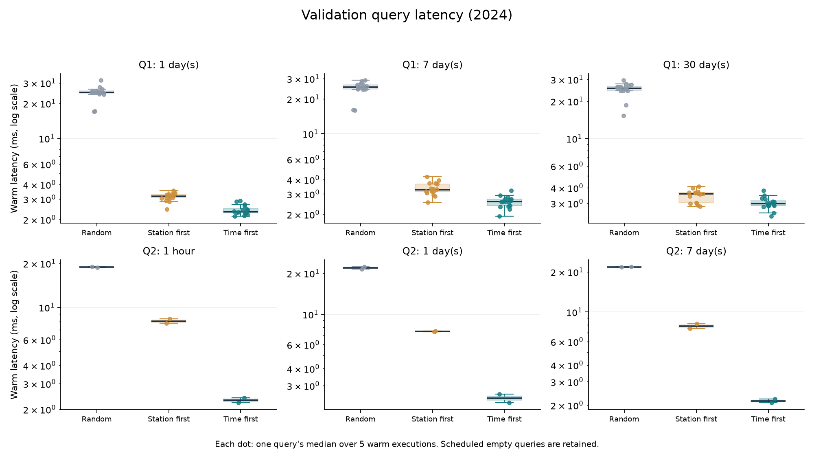
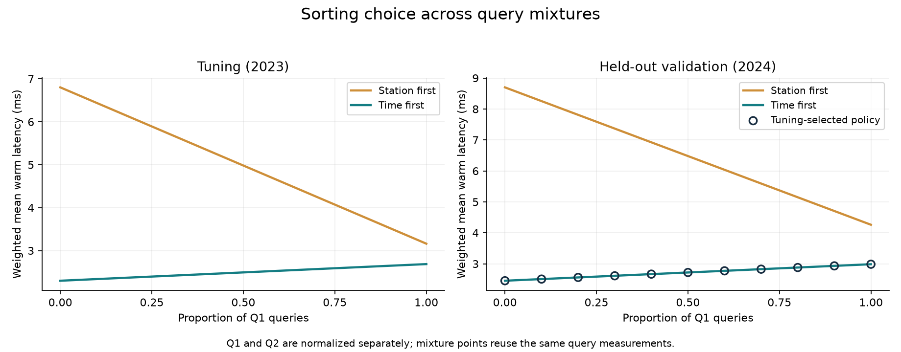
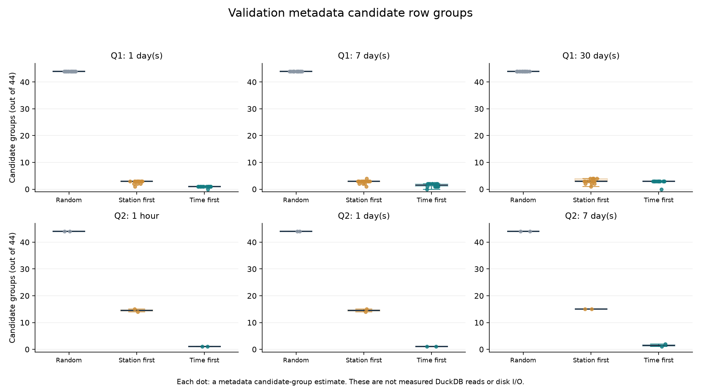
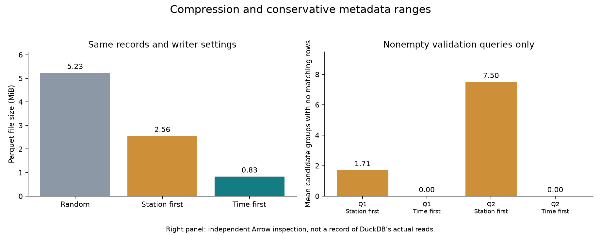

# 正式实验结果与排序选择验证

仓库：https://github.com/wzyonepp/ocean-data-mining

完成时间：2026-11-15T16:45:42.397351+08:00（香港时间）。

## 1. 完成情况与研究范围

按预留方案执行 108 条查询：54 条调整查询、54 条验证查询。三个 Parquet 布局均保持 713,823 条逻辑记录、44 个行组，以及相同的写入设置。324 次基表答案检查全部通过，保存 1,620 次计时和 324 次额外预热。

调整集有 3 条空查询，验证集有 6 条空查询，均为 Q1；按原计划保留，不依据性能替换。额外报告非空查询结果。

计时条件：Python 3.12.14、PyArrow 26.0.1、DuckDB 2.0.0，单查询线程，UTC，ZSTD 级别 3，每行组上限 16,384 行。查询直接读取同一组 Parquet 文件，采用预热后的引擎与系统缓存。

## 2. 类型归一后的平均耗时

下表按每条查询五次计时求平均，再在各查询类别内求平均，单位毫秒。Q1 与 Q2 分别归一，避免 48 条 Q1、6 条 Q2 的数量差异改变混合比例。图中的单查询分布另用五次中位数展示。

| 集合 | 类型 | 查询数（空结果数） | 随机 | 站点优先 | 时间优先 |
|---|---|---:|---:|---:|---:|
| 调整集 | Q1 | 48（3） | 23.796 | 3.161 | 2.685 |
| 调整集 | Q2 | 6（0） | 20.704 | 6.802 | 2.298 |
| 验证集 | Q1 | 48（6） | 27.187 | 4.261 | 2.986 |
| 验证集 | Q2 | 6（0） | 24.388 | 8.699 | 2.453 |



每个点代表一个查询五次测量的中位数，纵轴为对数刻度；箱线图描述不同查询的分布，不是置信区间。保留空查询，不能将所有点视作独立、同分布的重复实验。

## 3. 调整集选择与验证集评价

选择规则仅使用调整集耗时：对 Q1 比例 p∈{0,0.1,…,1}，按 p×Q1 平均耗时+(1-p)×Q2 平均耗时，选择站点优先或时间优先。选择结果在验证计时开始前保存，之后未修改。

**调整集在全部 11 个设定比例上都选择时间优先。** 本次数据没有支持“随 Q1 比例变化而切换排序”这一预期；选择规则退化为固定时间优先。它不构成相对固定时间优先的额外性能改进。

11 个比例点中，有 11 个选择与验证集两种固定排序中的较低均值一致，最大相对遗憾为 0.000%。比例点复用同一批查询测量，不能称为 11 次独立验证，也不意味着具有普遍最优性。

比例曲线由已保存的单查询计时加权估算，不是另行回放 11 组混合查询序列；本次没有检验比例改变时缓存或并发交互是否满足这一可加模型。



| Q1 比例 | 选择 | 验证：所选方案 ms | 验证：固定站点 ms | 验证：固定时间 ms | 遗憾 % |
|---:|---|---:|---:|---:|---:|
| 0.0 | 时间优先 | 2.453 | 8.699 | 2.453 | 0.000 |
| 0.5 | 时间优先 | 2.719 | 6.480 | 2.719 | 0.000 |
| 1.0 | 时间优先 | 2.986 | 4.261 | 2.986 | 0.000 |

## 4. 缺测与空查询的敏感性检查

去除空查询只用于已有测量的补充分析，不重新选择正式查询、不替换主结果。验证集非空 Q1 共 42 条，非空 Q2 共 6 条：

| 非空验证查询 | 随机 ms | 站点优先 ms | 时间优先 ms |
|---|---:|---:|---:|
| Q1 | 28.567 | 4.439 | 3.047 |
| Q2 | 24.388 | 8.699 | 2.453 |

该表用于检查结论是否主要由空结果驱动；其均值仍不能替代分站点、分窗口的具体结果。

## 5. 行组范围、边界混合与压缩



候选行组只表示按逐列 min/max 无法排除的组，不是 DuckDB 实际扫描行组或实际磁盘 I/O。另在全部计时结束后，用 PyArrow 单独读取两个有序布局的候选组，检查是否存在同时满足查询条件的记录。

| 非空验证查询 | 布局 | 平均候选组 | 平均含匹配组 | 平均无匹配候选组 |
|---|---|---:|---:|---:|
| Q1 | 站点优先 | 2.857 | 1.143 | 1.714 |
| Q1 | 时间优先 | 1.857 | 1.857 | 0.000 |
| Q2 | 站点优先 | 14.667 | 7.167 | 7.500 |
| Q2 | 时间优先 | 1.167 | 1.167 | 0.000 |



跨站点的边界组会使站点和时间的独立范围覆盖较宽，即使各条件都落在范围内，也可能没有联合匹配记录。独立行组诊断验证的是这一现象，不代表读取器没有其他跳过手段。统计跨查询累计次数时，同一物理行组可能被多个查询计入，因此是查询—行组组合次数，不是不同物理组的数量。

文件大小也受排序影响：随机为 5,485,899 字节，站点优先为 2,679,571 字节，时间优先为 875,334 字节。因此，本实验比较的是固定写入设置下排序的总体效果，不能把全部耗时差异单独归因于数据跳过。

## 6. 成本、局限和可写入报告的贡献

选择计算本身约 0.789 ms；用于调整集的两个候选布局探测查询（含额外预热）累计约 2018.065 ms，尚需考虑构建并保有两个布局的成本。本次未证明这些成本相对固定时间优先有额外回报。

结论限于当前 8 个站点、两个调整日期与两个验证日期、既定窗口、单机暖缓存及五次重复。当前样本不能代表全部浮标系统，也没有进行跨硬件或冷缓存验证；个别查询的均值或中位数差异不等于统计显著性。

可支撑的课程探索是：以受控实验检验站点/时间排序的适用边界，发现并核对边界行组的联合范围误保留，以及真实报告工作负载选择建议的验证结果和未获益情况。排序和工作负载布局已有研究，不声称算法首创。

若进一步探索按站点对齐行组，应另设扩展方案，因为它会改变行组边界；不能混入本次仅改变排序的对照。

## 7. 复现与原始证据

在仓库根目录安装 requirements-formal.txt 中的锁定依赖，然后按快照校验恢复本地输入。不要用重新筛查覆盖已提交的数据清单，否则取得时间等变化会使快照哈希改变。运行：

```bash
python code/restore_parquet_inputs.py
python code/run_parquet_formal.py --run-id formal_v1_replication
python code/analyze_parquet_formal.py --run-dir results/formal_v1_replication
```

恢复脚本只写 data/ 下的输入和恢复日志，不改动已提交的源数据或结果清单；若上游响应无法匹配原 SHA-256，会明确失败，不静默使用新版本。新运行 ID 用于保留本次证据；分析脚本只读取保存结果，不再次执行查询。

- [冻结条件与实际环境](../results/formal_v1/protocol.json)
- [冻结的调整集选择](../results/formal_v1/frozen_selection.json)
- [逐次测量](../results/formal_v1/measurements.csv)
- [逐查询耗时汇总](../results/formal_v1/query_summary.csv)
- [逐比例选择验证](../results/formal_v1/selection_validation.csv)
- [逐候选组联合匹配诊断](../results/formal_v1/joint_match_diagnostic.csv)
- [结果完整性检查](../results/formal_v1/artifact_verification.json)
- [图表 PNG 与 PDF](../results/formal_v1/figures/)
