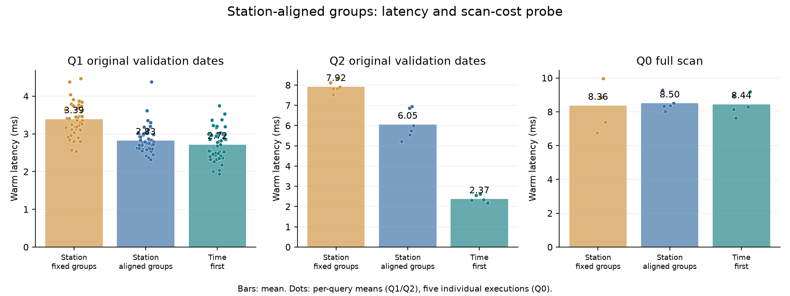
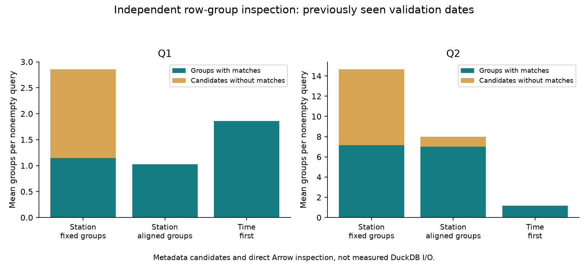
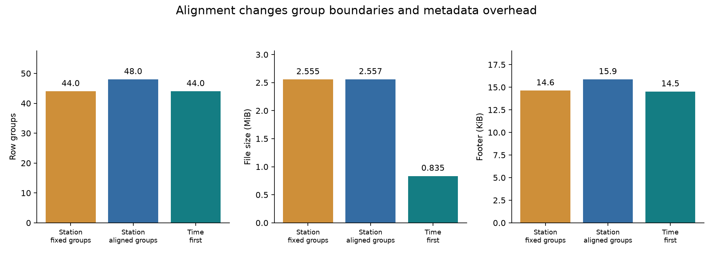

# 扩展结果：站点边界对齐行组

本结果随新日期验证一并同步仓库。属于探索性扩展，使用已经看过的 108 条查询，不是新的盲验证。

## 完成情况

新布局保持与原站点优先完全相同的记录和行序，每组最多 16,384 行，按站点边界重新开始。三种布局在本轮同时交错重新计时，不与上轮毫秒数直接比较。

108 条查询 × 3 布局 × 5 次，共 1,620 次计时；另有无筛选全表 COUNT/AVG 查询 Q0 的 15 次计时，总计 1,635 次、327 次预热和327次答案检查。全部通过。分批写入接口重建的原站点优先文件与原文件逐字节一致，新增布局读回后的行序及值也完全一致。

## 查询收益

下表为原验证日期组的类型平均耗时，仍包含预设空结果，单位毫秒。

| 查询 | 原站点优先 | 站点边界对齐 | 时间优先 | 对齐相对原站点耗时下降 |
|---|---:|---:|---:|---:|
| Q1 | 3.392 | 2.827 | 2.715 | 16.7% |
| Q2 | 7.917 | 6.049 | 2.366 | 23.6% |



相对原站点优先，两类查询的均值都有改善；时间优先的类型均值仍更低。结果支持本次对齐改动有局部收益，尚不支持它替代时间优先成为通用最佳布局。

排除空结果后，42 条非空单站点查询的平均耗时依次为：原站点优先 3.433 ms、边界对齐 2.863 ms、时间优先 2.786 ms；改善并非仅由空查询驱动。

## 机制核查

| 非空查询 | 布局 | 平均候选组 | 平均实际含匹配组 | 平均无匹配候选组 |
|---|---|---:|---:|---:|
| Q1 | station_first | 2.857 | 1.143 | 1.714 |
| Q1 | station_aligned | 1.024 | 1.024 | 0.000 |
| Q1 | time_first | 1.857 | 1.857 | 0.000 |
| Q2 | station_first | 14.667 | 7.167 | 7.500 |
| Q2 | station_aligned | 8.000 | 7.000 | 1.000 |
| Q2 | time_first | 1.167 | 1.167 | 0.000 |



对齐消除了跨站点混合组，非空 Q1 的无联合匹配候选组从平均 1.714 个降为 0。Q2 对齐后仍存在无匹配候选组，单站点内部的时间间断也可能产生范围误保留；不能把所有误保留都归因于跨站边界。上述检查由计时之外的 Arrow 直接读取完成，不代表 DuckDB 实际扫描组或磁盘 I/O。

## 开销与代价

| 项目 | 原站点优先 | 边界对齐 | 时间优先 |
|---|---:|---:|---:|
| row_groups | 44 | 48 | 44 |
| short_groups | 1 | 8 | 1 |
| min_group_rows | 9311 | 1669 | 9311 |
| file_bytes | 2679571 | 2681507 | 875334 |
| footer_bytes | 14979 | 16248 | 14866 |

对齐后增加 4 个行组、7 个尾部短组；文件仅增加 1,936 字节（0.072%），footer 增加 1,269 字节。更多行组不必然导致明显的总文件膨胀，编码和压缩效果同时发生变化。

| 全表扫描 Q0 | 原站点优先 | 边界对齐 | 时间优先 |
|---|---:|---:|---:|
| 五次平均 ms | 8.362 | 8.500 | 8.444 |
| 五次中位数 ms | 8.850 | 8.363 | 8.289 |

Q0 均值略增而中位数方向相反，不能用这五次探针证明全表扫描有稳定的性能损失或提升。Q0 不采用候选列块字节估计作为 I/O 指标。



## 结论与局限

本次扩展达到了“针对已观察问题提出改动，并验证局部收益”的目标：保持站点排序，按站点对齐行组，确实减少了范围误保留，并降低了相对原站点优先的类型平均耗时。同时也保留了重要边界：时间优先仍更快，更多小组增加元数据，实际全表开销尚不稳定。

该方法属于常见聚集和分组设计思路，不声称全球首创。本轮用了已见查询，只有单机暖缓存和五次重复；没有匹配行组数量的额外控制，不能独立拆分对齐和组数变化的全部效应。形成报告时，应明确将其标为探索性改进，后续如需确认泛化，可另选未见日期。

## 复现

在既有锁定环境和恢复输入后执行：

```bash
python code/run_alignment_extension.py --run-id alignment_v1_replication
python code/analyze_alignment_extension.py --run-dir results/alignment_v1_replication
```

- [逐次测量](../results/alignment_v1/measurements.csv)
- [结果检查](../results/alignment_v1/artifact_verification.json)
- [协议与版本](../results/alignment_v1/protocol.json)
- [文件、行组和存储统计](../results/alignment_v1/layouts.json)
- [机制逐组诊断](../results/alignment_v1/joint_match_diagnostic.csv)
