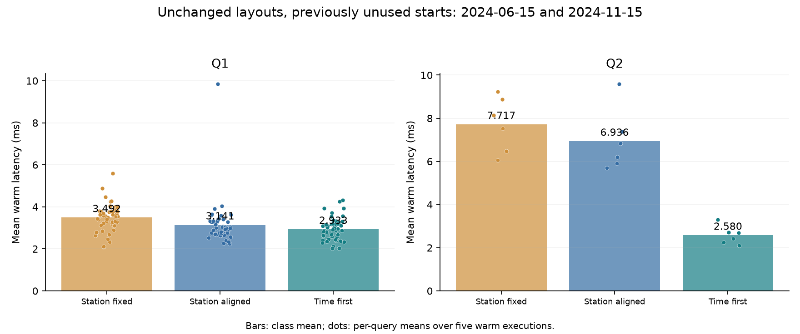
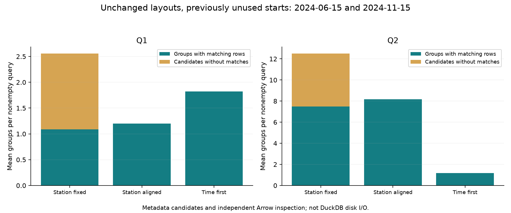

# 新日期验证结果

在测量前锁定 2024-06-15、2024-11-15 两个新起始日，与之前全部性能查询的起始日不相交。布局和参数未修改。54 条查询、162 次答案检查、810 次计时、162 次额外预热全部完成。3 条 Q1 为空结果，保留在主要分析中。

| 查询 | 原站点优先 ms | 边界对齐 ms | 时间优先 ms | 相对原站点下降 |
|---|---:|---:|---:|---:|
| Q1 | 3.492 | 3.141 | 2.933 | 10.05% |
| Q2 | 7.717 | 6.936 | 2.580 | 10.12% |

收益在新查询日期上保持同方向，但幅度小于探索轮的 16.65% 和 23.60%；时间优先的类型均值仍更低。排除空结果后，Q1 的三种布局平均耗时分别为 3.579、3.196、2.992 ms，改善并非只由空查询产生。

非空 Q1 的原站点优先平均无匹配候选组为 1.467，对齐后为 0.000。候选组是元数据估算，联合匹配由额外 Arrow 读取核对，均不是实测 DuckDB I/O。所有方法使用同一历史数据和硬件，仅查询日期是新日期；不称为跨独立数据集验证，五次重复不支撑普遍最优或统计显著性结论。

原始记录见 [measurements.csv](../results/alignment_fresh_v1/measurements.csv)，冻结条件见 [protocol.json](../results/alignment_fresh_v1/protocol.json)，检查见 [artifact_verification.json](../results/alignment_fresh_v1/artifact_verification.json)。运行命令：`python code/run_alignment_fresh_dates.py --run-id fresh_replication`。新运行 ID 不覆盖旧证据；本报告与图表可用 `python code/build_final_report.py` 从保存结果重新生成，无需重新计时。
