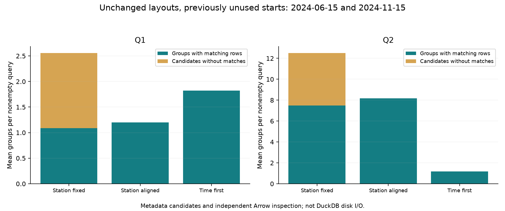

# 浮标时序 Parquet 布局中站点边界对齐的效益与代价

**海洋数据挖掘课程大作业实验报告**

**公开仓库：https://github.com/wzyonepp/ocean-data-mining**  
**AI 协作记录：[指定范围对话记录](../ai_logs/01_课程解读到实验预跑.md)**  
日期：2026 年 11 月 15 日（香港时间）。提交人姓名、学号：提交时填写。

## 摘要

本实验从第二章“Parquet 排序与行组跳过”出发，研究浮标时序数据中站点优先和时间优先的取舍。在 8 个 NOAA NDBC 站点、2023—2024 年共 713,823 条非缺测水温记录上，先完成三种排序布局的对照，发现时间优先在两类查询中的平均耗时均更低；根据查询类型比例选择布局，也没有比始终使用时间优先进一步缩短耗时。随后通过独立读取行组，发现按固定行数划分行组时，部分行组跨越站点边界；各列的范围统计无法排除其中实际没有匹配记录的行组。扩展方案保持站点优先行序，将行组在站点边界处重新开始。在已测试的查询上复测后观察到部分改进，再用预先锁定的两个新起始日期验证：相对原站点优先，单站点与跨站点查询平均耗时分别下降 10.05% 和 10.12%，时间优先在这两类查询中的平均耗时仍更低。对齐增加 4 个行组与 1,936 字节文件体积。报告分析了耗时改善的可能机制和额外代价，同时列出没有改善的查询及结论的适用范围。

## 1. 研究问题与边界

课程第三讲指出，列式格式提供读取基础，排序、分区和合并决定数据跳过是否有效。本课题仅研究文件内的排序及后续的站点边界对齐，不建设湖仓平台，不比较分区算法、空间索引或预测模型。

初始问题是：相同数据按 `(station_id, observation_time)` 或 `(observation_time, station_id)` 排列，分别适合什么查询？扩展问题是：保持第一种行序不变，让新站点从新的行组开始，能否减少实际没有匹配记录的候选行组、缩短查询耗时，又会增加多少开销？

本实验的贡献是针对海洋浮标数据发现具体问题、修改分组规则，并在相同条件下进行对照验证。排序、聚集、按站点分组和根据查询需求优化布局，都是已有思路。

## 2. 相关资料与既有方法

Parquet 按行组组织数据，每个行组内部按列存储，并在文件末尾保存描述文件结构和各行组的信息（footer，文件尾部元数据）[1]。DuckDB 读取 Parquet 时，可以只读取查询需要的列，并利用各列的最小值、最大值（min/max）排除不可能包含匹配记录的行组[2]。尚不能被这些统计信息排除的行组，本文称为“候选行组”；候选行组中也可能没有实际匹配的记录。排序通常能缩小各组的数值或时间范围，使无关行组更容易被跳过[3]。PyArrow 的 `sorting_columns` 只描述顺序，不执行排序，因此本实验先实际重排记录再写入[4]。

根据查询需求设计数据布局，已有 Qd-tree 等研究[5]。近期对开放列式格式的研究还强调编码、解码、缓存和执行接口的共同影响[6]。因此，不能把“按查询需求选布局”直接算成新算法，也不能将耗时差异全部归因于候选行组数量。本实验聚焦于可以逐组检查的小范围对照，不复现完整的学习型布局优化框架。

## 3. 数据来源与处理

数据来自 NOAA NMFS SWFSC ERD 的 ERDDAP 数据集 `cwwcNDBCMet`。该数据集对 NDBC 观测进行了标准化、重整和少量编辑[7]。站点为 41001、41002、41004、41008、41009、41010、41013、41025，每站分别取得 2023、2024 年三个字段 `station,time,WTMP`，共 16 个 CSV。

共下载 734,800 条记录，其中水温有效记录为 713,823 条，缺测记录为 20,977 条；没有站点和观测时间均相同的重复记录。处理时统一剔除 NaN、无穷值及提供方标记的缺测水温，不插值补齐，也不通过复制记录扩大数据规模。`station_id` 保留字符串，观测时间为 UTC 微秒时间戳，水温为摄氏度 float64。浮标传感器水温不等同于卫星皮肤温度；实际传感器深度应参考站点说明。

各站点的观测时间覆盖不均，部分查询没有匹配记录。实验保留预先选定的这些查询，并额外检查排除空结果后结论是否一致。`AVG(sst)` 是匹配观测记录的简单平均，不用于估计海域面积加权温度。逐文件 URL、取得时间、SHA-256 和缺测统计见 [数据清单](../results/data_screening_manifest.json)。

## 4. 实验设计与可复现性

共同条件：Python 3.12.14、PyArrow 26.0.1、DuckDB 2.0.0，单查询线程、UTC、一个不分区文件、ZSTD 级别 3 压缩、站点列使用字典编码、开启行组统计、关闭页索引（page index）、每组最多 16,384 行。环境是单机 Linux，容器内存上限 8 GiB，CPU 配额约 2 核。固定参数见 [配置](../config/pilot_v1.json)，依赖见 [requirements-formal.txt](../requirements-formal.txt)。

Q1 指定站点，时间窗口为 1、7、30 天；Q2 不限制站点，窗口为 1 小时、1、7 天，时间范围均包含起点、不包含终点，返回记录数 COUNT 和平均水温 AVG。每条查询在每种布局上先与基准表的结果核对，再执行一次不计时的预热和五次计时。使用固定随机种子打乱查询顺序，并轮换三种布局的执行顺序。计时含执行、绑定、计划和结果提取，不包含布局构建和诊断。完整读取文件和正确性检查已使部分数据进入缓存，因而本研究测量的是预热后的查询表现，不代表首次从磁盘读取时的性能。

| 阶段 | 查询 | 答案检查 | 计时 | 用途 |
|---|---:|---:|---:|---|
| 预跑 | 12 × 3 布局 | 36 | 180 | 正确性与可行性 |
| 原始正式对照 | 108 × 3 布局 | 324 | 1,620 | 排序比较、调整及验证 |
| 对齐探索复测 | 108 条 + 全表 Q0，3 布局 | 327 | 1,635 | 使用已测试查询分析改动效果 |
| 两个新日期验证 | 54 × 3 布局 | 162 | 810 | 不修改方法的新查询复核 |

每个阶段都在同一轮实验中重新测量相应的对照布局，避免把不同轮次的耗时直接相减来计算改进。各布局返回的记录数均一致，平均水温按绝对误差 1e-9 或相对误差 1e-12 的容差核对。将各布局的数据读回并按相同规则排序后，数据内容的校验值一致；边界对齐布局还与原站点优先布局逐行核对，确认行序和值完全相同。

## 5. 原始实验与问题诊断

原始布局为随机、站点优先、时间优先，各 44 个行组。108 条正式查询分为 54 条调整查询和 54 条验证查询。调整日期为 2023-02-01、2023-08-01；验证日期为 2024-02-01、2024-08-01。验证集 Q1 的平均耗时分别为随机 27.187、站点优先 4.261、时间优先 2.986 ms；Q2 的平均耗时为 24.388、8.699、2.453 ms。

布局选择只使用调整集的结果：设 Q1 在全部查询中的比例为 p，先对 Q1、Q2 两类查询的平均耗时分别归一化，再按比例加权比较。测试的 11 个 p 值均选择时间优先，选择结果在验证计时前固定。在验证集中，时间优先的两类查询平均耗时也都更低，因此这条选择规则没有优于始终使用时间优先。比例曲线由已有单条查询的计时加权估算，没有实际执行 11 套混合查询序列。

独立检查发现，固定行数切组会在两个站点的交界处混合记录。由于每个站点内部的时间重新从早到晚排列，边界组可能覆盖很宽的时间段。逐列统计保留了站点范围和时间范围，却没有记录两者的联合关系，因而可能无法排除零匹配的组。

例如预跑的 41002 单日查询中，原站点优先保留 3 个候选组，但实际只有 1 个组含匹配行。正式对照的非空 Q1 查询平均存在 1.714 个实际没有匹配记录的候选行组。这些统计由 Arrow 额外读取各行组并逐条核对得到；实验没有跟踪 DuckDB 实际读取了哪些行组或多少字节。

## 6. 原创探索点的具体拆解

### 6.1 贡献定位：已有知识、借鉴思路与本项目新增工作

本项目围绕浮标时序查询，**实现站点边界对齐策略，并验证查询改进和额外代价**。这里的原创探索指本课程项目中完成的问题诊断、方案选择、对照实验和结果分析，不声称首次提出按站点等实体分组的思路。

| 层次 | 内容 | 本报告中的作用与贡献边界 |
|---|---|---|
| 课堂已有知识 | 列式布局、行组、排序和 min/max 跳过 | 实验起点，不计为新增方法 |
| 已有设计思路 | 将同一实体的数据放在一起、控制分组边界、根据查询需求设计布局 | 可借鉴的技术基础，不声称首创 |
| 本项目的问题诊断 | 在具体浮标文件中找出站点边界混合组，核对候选行组是否有同时满足站点和时间条件的记录 | 用实际文件说明范围统计为何未能排除无匹配行组 |
| 本项目的具体改动 | 保持站点优先行序，在站点切换处重新开始行组，尾部不足上限也保留为独立组 | 与原固定切组相比改变组边界，不改变逻辑数据和查询 |
| 本项目的验证设计 | 用相同写入接口重建原布局并逐字节核对、同轮复测原查询、另用新日期验证、检查存储与全表扫描耗时 | 验证结果正确性、局部改进、额外代价及适用范围 |

Qd-tree[5] 研究如何根据查询需求组织数据布局，可作为相关工作的参考。但引用这一研究不能证明站点边界对齐此前无人使用。当前尚未全面比较所有相近方法，因此本文不作方法首创的判断，贡献以本项目实际完成的实现、诊断和实验为准。

### 6.2 为什么按站点排序仍会保留无匹配行组：真实例子

查询条件为 `station_id = '41002'`，时间为 `[2023-03-15 00:00 UTC, 2023-03-16 00:00 UTC)`。按独立范围统计，一个行组只有在站点区间包含 41002、且时间区间与查询窗口相交时才保留为候选。写成必要条件即：

```text
station_min <= target_station <= station_max
AND time_max >= query_start
AND time_min < query_end
```

这些条件同时成立，不意味着存在**同一条记录**同时满足站点和时间条件。逐列 min/max 只记录各列的范围，没有记录某个站点具体对应哪些时间。

预跑文件中实际检查到以下三个候选组，编号从 0 开始：

| 行组 | 站点范围 | 时间范围（仅展示日期） | 独立读取后的实际匹配行数 |
|---|---|---|---:|
| 4 | 41001—41002 | 2023-01-01 至 2024-09-20 | 0 |
| 5 | 41002—41002 | 2023-03-05 至 2023-06-27 | 144 |
| 10 | 41002—41004 | 2023-01-01 至 2024-12-30 | 0 |

第 4、10 号组的独立范围都包含查询条件，但没有同时满足站点与时间条件的记录；第 5 号组才含 144 条目标记录。这是从文件中读出的案例，不是构造的测试数据。完整时间边界及原始诊断见 [boundary_diagnostic.json](../results/pilot_v1/boundary_diagnostic.json)。它解释统计范围的局限，不代表 DuckDB 实际读取了哪几个组。

下面只示意分组规则，不对应上述真实行组编号。为便于展示，将上限简化为 8 条，每个字母代表一条示意记录；实际实验上限仍为 16,384 行：

```text
同一份站点优先行序：AAAAAA BBBBBBB CCCC

固定行数切组：     [AAAAAA BB] [BBBBB CCC] [C]
                         ↑ 混合边界组 ↑
按站点边界对齐：   [AAAAAA] [BBBBBBB] [CCCC]
```

两种方式都不改变行序。区别在于是否允许一个行组跨越站点；对齐会保留更多不足上限的尾部组。

### 6.3 精确定义改动与实现

将记录先按 `(station_id, observation_time)` 升序排列，设行组行数上限 R=16,384。每个站点的数据独立分批写入，同一文件保持打开：

```text
sorted_rows = sort(rows, station_id, observation_time)
open one ParquetWriter with the common schema and writer settings
for station in sorted(nonempty_station_ids):
    segment = filter(sorted_rows, station_id == station)
    for start in range(0, len(segment), R):
        write segment[start : start + R] as one row group
    # 尾部不足 R 行也已写出；下一站点不得拼入这个尾组
close writer
```

实际代码也是逐站筛选数据，再按行数切片写入，并未实现只遍历一次数据的流式写入。每个站点少于 R 行时写一组，没有记录的站点不写组；生成布局前已统一剔除缺测水温，并检查站点与时间的组合是否重复。代码入口见 [run_alignment_extension.py](../code/run_alignment_extension.py)。

设总记录数为 N，有记录的站点 s 包含 n_s 条记录，ceil 表示向上取整。普通固定分组的行组数为 `ceil(N/R)`，边界对齐后的行组数为 `sum_s ceil(n_s/R)`，即分别计算每个站点需要的组数，再求和。本数据对应 44 与 48；每组仍不超过 R，但总组数和各组行数会变化。这个公式只说明组数如何变化，并不证明这种分组方式最优。

### 6.4 与相关方法的区别及对照条件

| 方案 | 全局行序 | 行组边界 | 文件组织 | 本实验是否测量 |
|---|---|---|---|---|
| 普通站点优先 | 站点、时间 | 全表每 R 行切分，可能跨站点 | 单文件、不分区 | 是，直接对照 |
| 本次站点边界对齐 | 同样的站点、时间行序 | 在站点切换处重新开始 | 同一个文件、不建站点目录 | 是，扩展方案 |
| 时间优先 | 时间、站点 | 全表每 R 行切分 | 单文件、不分区 | 是，性能更好的对照 |
| 按站点目录分区 | 不自动保证文件内行序 | 取决于各分区的写入实现 | 改变目录与文件组织 | 否，仅作概念比较 |

各方案使用相同的数据、字段类型、查询、压缩设置、编码设置和行组行数上限。原站点优先有 7 个跨站点组，新布局为 0。为排除分批写入接口本身造成文件差异，先用同一 ParquetWriter 接口按原固定边界重建对照布局，生成文件与原文件逐字节完全一致；新布局完整读回也与原站点优先行序、值完全一致。证据见 [writer_control.json](../results/alignment_v1/writer_control.json)。

边界对齐也会改变行组数量、各组行数，并可能影响压缩效果。本实验验证的是**整套分组策略的总体效果**。由于没有增加行组数量相同的对照方案，无法将观察到的改进全部归因于边界变化本身。

### 6.5 探索阶段的改进、代价与适用范围

探索阶段使用之前测试过的 108 条查询，在同一轮中复测各布局。其中，属于原验证日期的 Q1 平均耗时从 3.392 降为 2.827 ms（下降 16.65%），Q2 平均耗时从 7.917 降为 6.049 ms（下降 23.60%）；同轮时间优先的平均耗时为 2.715 和 2.366 ms，仍然更低。该轮用于探索改动效果，随后预先确定新日期进行验证，最终结论采用新日期的结果。

相应代价是行数不足上限的行组增多，元数据也随之增加。对齐增加 4 个行组、7 个尾部短组及 1,936 字节文件体积；没有系统测量构建、重写和维护成本。当前实现需要逐站筛选，并在内存中生成各站点的数据，在站点很多时可能增加处理时间和内存占用。因此，文件仅增长 0.072% 并不说明生成和维护这种布局的总代价很小。

当站点数量很多、每站记录很少，或者查询需要扫描很长的时间范围时，这种分组方式可能不再有效；这些情况尚未测试，只是后续需要验证的推测。在本数据上，时间优先的两类查询平均耗时仍然更低。本项目的贡献是发现具体问题、实现改动，并同时检查改善、不利结果和额外代价。

## 7. 使用预先确定的新日期验证

在不改变布局或参数的前提下，固定 2024-06-15、2024-11-15 两个此前没有计时过的起始日。8 站点 × 3 窗口 × 2 日期产生 48 条 Q1；3 窗口 × 2 日期产生 6 条 Q2，共 54 条、810 次计时。这两个起始日均未用于之前的性能查询。162 次结果核对全部通过，3 条没有匹配记录的 Q1 仍保留在统计中。

| 查询 | 原站点优先 ms | 边界对齐 ms | 时间优先 ms | 相对原站点优先的耗时下降 |
|---|---:|---:|---:|---:|
| Q1 | 3.492 | 3.141 | 2.933 | 10.05% |
| Q2 | 7.717 | 6.936 | 2.580 | 10.12% |


对齐相对原站点优先在新日期上继续保持改善，但幅度小于探索轮。正式结论采用新日期验证的结果。时间优先在两类查询中的平均耗时依然更低。

排除空结果后，Q1 的平均耗时为原站点优先 3.579、对齐 3.196、时间优先 2.992 ms，说明平均耗时的改善方向不变。



在新日期有匹配记录的 Q1 中，原站点优先布局每条查询平均有 1.467 个候选行组实际没有匹配记录，对齐后为 0；本轮有匹配记录的 Q2 也未发现这种情况。不过，探索轮的 Q2 在对齐后仍出现过这种行组。这表明，即使行组不再跨越站点，站点内部观测时间的间断仍可能使范围统计保留没有匹配记录的行组，不能据本轮结果断言这种情况已彻底消除。

### 7.1 逐条查询检查：并非每条查询都改善

对每条查询先计算五次计时的平均值，再比较两种布局，比较时使用未经四舍五入的数值。“更低”只表示本次测量值更小，不能据此判断差异是否具有统计显著性；表中包含预先确定的空结果查询。

| 类型 | 查询数 | 对齐后平均耗时更低 | 对齐后平均耗时未降低 |
|---|---:|---:|---:|
| Q1 | 48 | 37 | 11 |
| Q2 | 6 | 4 | 2 |

因此，两类查询平均耗时下降约 10%，不等于每条查询都更快。完整逐查询变化见 [per_query_effects.csv](../results/alignment_fresh_v1/per_query_effects.csv)。本文先对每类查询的耗时取等权平均，再比较两种布局的平均耗时，计算下降百分比；没有先计算每条查询的下降百分比再取平均。这两种计算方式不同，主结果始终使用前一种方式。

### 7.2 一次较长计时如何影响平均值

按平均耗时的相对变化比较，边界对齐表现最不利的查询来自 41013 站点，从 2024-11-15 UTC 开始查询 7 天，返回 1000 条记录。全部五次计时如下，单位毫秒，按重复轮次列出：

| 布局 | 五次原始计时 | 平均值 | 中位数 |
|---|---|---:|---:|
| 原站点优先 | 7.987, 3.218, 4.287, 3.547, 3.290 | 4.466 | 3.547 |
| 边界对齐 | 36.719, 2.635, 3.422, 3.144, 3.302 | 9.844 | 3.302 |
| 时间优先 | 9.953, 2.982, 2.828, 2.674, 3.106 | 4.309 | 2.982 |

边界对齐有一次查询耗时约 36.719 ms，明显长于其余四次。这种少数耗时较长的情况称为“长尾”，会抬高平均值；但对齐方案的中位数仍低于原站点优先。原站点优先与时间优先在该样例中也有较长计时。现有记录不能确定长尾的具体原因，既不能据此断言边界对齐会持续变慢，也不能只凭中位数较低就断言它会稳定变快。

分析保留全部原始计时，不删除较长的数值，也不更换预先确定的主要指标。平均值仍用于主要比较，中位数和逐次计时只作补充解释。每条查询只有五次计时，尚不足以可靠判断差异是否具有统计显著性，也不足以查明长尾出现的原因。机器负载、缓存与调度因素需要另行观测才能判断原因。本节只补充已有测量分析，没有重跑或重新选择查询。

## 8. 改进、代价与局限

### 8.1 改进效果

边界对齐减少了实际没有匹配记录的候选行组；新日期验证中，两类查询的平均耗时均低于原站点优先布局。不过，时间优先的两类查询平均耗时仍然更低，且并非每条查询都因对齐而变快，具体结果见第 7 节。

### 8.2 额外代价

| 文件与行组指标 | 原站点优先 | 边界对齐 | 时间优先 |
|---|---:|---:|---:|
| 行组数 | 44 | 48 | 44 |
| 不足行数上限的尾部行组 | 1 | 8 | 1 |
| 最小行组行数 | 9,311 | 1,669 | 9,311 |
| 文件字节数 | 2,679,571 | 2,681,507 | 875,334 |
| 文件尾部元数据（footer）字节数 | 14,979 | 16,248 | 14,866 |

对齐相对原站点优先增加 4 组、1,936 字节（约 0.072%）文件体积，以及 1,269 字节的文件尾部元数据。探索轮还执行了不带筛选条件的全表查询 Q0。按原站点优先、边界对齐、时间优先的顺序，五次查询的平均耗时分别为 8.362、8.500、8.444 ms；中位数为 8.850、8.363、8.289 ms，均值与中位数的变化方向不同，现有测量不足以确认边界对齐是否会持续增加全表扫描耗时。


本节测量了行组数量、文件大小、尾部元数据大小和一条全表扫描查询的耗时。生成新布局、重写已有文件和日常维护的额外时间与资源消耗，尚未系统测量，因此不能仅凭文件增大约 0.072% 就认为整体代价很小。

相同设置下，时间优先布局压缩后的文件明显更小。因此排序和分组的总体影响包含压缩、解码和跳过等因素，不能将全部提速归因于候选组减少。根据元数据推算的候选行组数、用 Arrow 核对的实际含匹配记录行组数，以及 DuckDB 实际读取量，是不同指标。跨查询累计没有匹配记录的行组时，同一行组可能被多条查询重复计数，累计值不代表不同的物理行组个数。

### 8.3 实验局限

实验只覆盖 8 个站点、同一份历史数据、两个新查询起始日、固定的行组行数上限，以及单机预热缓存下每条查询五次计时。新查询日期并不等于新数据集。实验也没有增加行组数量相同的对照方案，因而无法单独区分边界变化和组数变化的影响。约 10% 的改善表示整套策略在当前条件下对两类查询平均耗时的影响，不能全部归因于边界变化本身。

此外，本实验没有验证未预热缓存、并发查询或不同硬件下的表现，也没有证明每条查询都更快，或性能差异具有统计显著性。新日期验证前没有修改策略；如果后续继续改动，应另外预留未测试的查询进行验证。

## 9. 结论

在本实验中，时间优先是总体表现更好的对照布局，根据查询类型比例选择布局没有带来进一步改进。针对固定行数分组可能保留无匹配行组的问题，站点边界对齐在保持数据、行序和写入设置不变的条件下，减少了实际没有匹配记录的候选行组。使用预先确定的新日期验证时，Q1、Q2 的平均耗时相对原站点优先均下降约 10%。代价是行组和元数据增多，文件大小略有增加；现有全表查询测量不足以判断是否会持续增加扫描耗时。

这一结果支持在本实验场景下采用边界对齐来改进原站点优先布局，但不说明它是通用的最佳布局，也不代表首次提出这种分组思路。

## 10. AI 协作记录、复现与提交核查

工作按课程解读、选题、资料与数据筛查、对照、诊断、扩展、新日期验证及报告整理逐步完成。AI 协助整理资料、实现与排错、计算和作图；对话记录保留实际交互，不补造个人预测或辩论。按用户要求排除指定不记录的轮次及连续解释讨论，范围见日志说明；该记录不是无删节全文，未宣称完全满足“无删节完整记录”的要求。

按指定版本安装依赖后，先恢复输入数据，再运行实验脚本。仓库不保存原始 CSV 和 Parquet 文件，而是提供数据来源、SHA-256 校验值和恢复工具。如果上游历史数据发生修订、无法通过校验，应记录为新数据版本，不直接替换原实验输入。

```bash
python -m pip install -r requirements-formal.txt
python code/restore_alignment_inputs.py
python code/run_alignment_fresh_dates.py --run-id fresh_replication
```

恢复脚本按已提交快照重建原始与对齐布局，并验证文件 SHA-256，不覆盖已提交结果清单。使用新的运行 ID 将结果另存，保留原始证据；如需重跑探索轮，可单独运行 `python code/run_alignment_extension.py --run-id alignment_replication`。报告和图表可用 `python code/build_final_report.py` 根据保存结果重新生成，无需重跑 SQL。

数据与结果入口：[原始正式结果](07_formal_results.md)、[探索扩展](09_alignment_results.md)、[新日期验证](11_fresh_dates_results.md)、[新日期原始计时](../results/alignment_fresh_v1/measurements.csv)、[验证检查](../results/alignment_fresh_v1/artifact_verification.json)。姓名、学号和学校要求的版式在提交时填写与核对，技术结果保留原始证据。

## 参考资料

[1] Apache Parquet, File Format. https://parquet.apache.org/docs/file-format/  
[2] DuckDB, Reading and Writing Parquet Files. https://duckdb.org/docs/2.0/data/parquet/overview  
[3] DuckDB, Parquet Tips. https://duckdb.org/docs/2.0/data/parquet/tips  
[4] Apache Arrow, pyarrow.parquet.write_table. https://arrow.apache.org/docs/python/generated/pyarrow.parquet.write_table.html  
[5] Yang Z., et al. Qd-tree: Learning Data Layouts for Big Data Analytics. SIGMOD 2020. https://doi.org/10.1145/3318464.3389770  
[6] Liu C., Pavlenko A., Interlandi M., Haynes B. Data formats in analytical DBMSs: performance trade-offs and future directions. The VLDB Journal 34, 30 (2025). https://doi.org/10.1007/s00778-025-00911-1  
[7] NOAA ERDDAP, NDBC Standard Meteorological Buoy Data, cwwcNDBCMet. https://upwell.pfeg.noaa.gov/erddap/info/cwwcNDBCMet/index.html  
课程依据：用户提供《第二章 第3讲 列式布局与AI数据底座》，文件页序第4、6、7、9页。资料查阅过程见 [资料调研记录](02_literature_review.md)。
