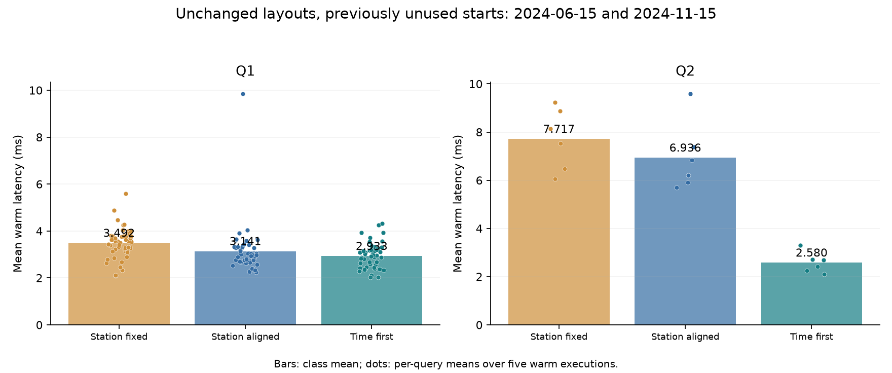
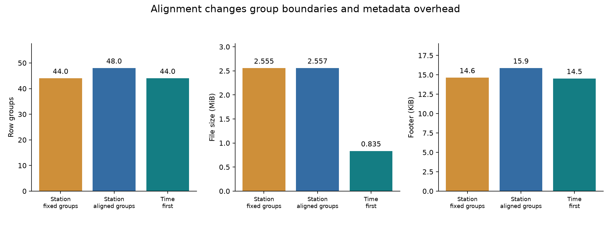

# 浮标时序 Parquet 布局中站点边界对齐的效益与代价

**海洋数据挖掘课程大作业实验报告**

**公开仓库：https://github.com/wzyonepp/ocean-data-mining**  
**AI 协作记录：[指定范围对话记录](../ai_logs/01_课程解读到实验预跑.md)**  
日期：2026 年 11 月 15 日（香港时间）。提交人姓名、学号：提交时填写。

## 摘要

本实验从第二章“Parquet 排序与行组跳过”出发，研究浮标时序数据中站点优先和时间优先的取舍。在 8 个 NOAA NDBC 站点、2023—2024 年共 713,823 条非缺测水温记录上，先完成三种排序布局的对照，发现时间优先在既定查询类型的均值上占优，按查询比例选择未比固定时间优先增加收益。随后通过独立读取行组，定位固定切组在站点边界混合记录、导致逐列范围保留无联合匹配组的问题。扩展方案保持站点优先行序，将行组在站点边界处重新开始。探索复测得到局部收益，再用预先锁定的两个新起始日期验证：相对原站点优先，单站点与跨站点查询平均耗时分别下降 10.05% 和 10.12%，时间优先仍更快。对齐增加 4 个行组与 1,936 字节文件体积。实验提供了收益、机制与成本的证据，同时保留未获益和适用边界。

## 1. 研究问题与边界

课程第三讲指出，列式格式提供读取基础，排序、分区和合并决定数据跳过是否有效。本课题仅研究文件内的排序及后续的站点边界对齐，不建设湖仓平台，不比较分区算法、空间索引或预测模型。

初始问题是：相同数据按 `(station_id, observation_time)` 或 `(observation_time, station_id)` 排列，分别适合什么查询？扩展问题是：保持第一种行序不变，重置站点之间的行组边界，能否减少无效候选组并改善耗时，增加多少开销？

本实验的贡献限定为海洋浮标场景中的问题诊断、分组改动和受控验证，不声称排序、聚集、站点分组或工作负载优化的思想首创。

## 2. 相关资料与既有方法

Parquet 将列块组织为行组，并保存末尾元数据[1]。DuckDB 可将筛选与投影下推到 Parquet 读取，利用 min/max 排除不可能匹配的组[2]；范围紧密的有序排列更有利于跳过[3]。PyArrow 的 `sorting_columns` 只描述顺序，不执行排序，因此本实验先实际重排记录再写入[4]。

工作负载驱动布局已有 Qd-tree 等研究[5]。近期对开放列式格式的研究还强调编码、解码、缓存和执行接口的共同影响[6]。因此，不能把“按查询需求选布局”直接算成新算法，也不能将耗时差异全部归因于候选行组数量。本实验采用小范围的可解释对照，而不复现完整学习布局框架。

## 3. 数据来源与处理

使用 NOAA NMFS SWFSC ERD 的 ERDDAP `cwwcNDBCMet`，是对 NDBC 数据标准化、重整和轻度编辑后的版本[7]，不是完全未经处理的原始观测。站点为 41001、41002、41004、41008、41009、41010、41013、41025，每站分别取得 2023、2024 年三个字段 `station,time,WTMP`，共 16 个 CSV。

下载共 734,800 条记录，水温非缺测 713,823 条、缺测 20,977 条；重复站点—时间键为 0。统一剔除非有限水温及提供方缺测标记，不插值、不复制扩容。`station_id` 保留字符串，观测时间为 UTC 微秒时间戳，水温为摄氏度 float64。浮标传感器水温不等同于卫星皮肤温度；实际传感器深度应参考站点说明。

各站覆盖不均，查询可能为空；预先确定的空查询保持不变并另做非空敏感性分析。`AVG(sst)` 是匹配观测记录的简单平均，不用于估计海域面积加权温度。逐文件 URL、取得时间、SHA-256 和缺测统计见 [数据清单](../results/data_screening_manifest.json)。

## 4. 实验设计与可复现性

共同条件：Python 3.12.14、PyArrow 26.0.1、DuckDB 2.0.0，单查询线程、UTC、一个不分区文件、ZSTD 级别 3、站点列字典编码、开启行组统计、关闭 page index、每组最多 16,384 行。环境是单机 Linux，容器内存上限 8 GiB，CPU 配额约 2 核。固定参数见 [配置](../config/pilot_v1.json)，依赖见 [requirements-formal.txt](../requirements-formal.txt)。

Q1 指定站点，时间窗口为 1、7、30 天；Q2 不限制站点，窗口为 1 小时、1、7 天，均为半开区间，返回 COUNT 和 AVG。每个查询—布局组合先核对基表答案，再额外预热一次、计时五次，固定种子打乱查询顺序并轮换布局顺序。计时含执行、绑定、计划和结果提取，不包含布局构建和诊断。完整读回和正确性检查已预热缓存，本研究不测冷磁盘性能。

| 阶段 | 查询 | 答案检查 | 计时 | 用途 |
|---|---:|---:|---:|---|
| 预跑 | 12 × 3 布局 | 36 | 180 | 正确性与可行性 |
| 原始正式对照 | 108 × 3 布局 | 324 | 1,620 | 排序比较、调整及验证 |
| 对齐探索复测 | 108 条 + 全表 Q0，3 布局 | 327 | 1,635 | 已见查询上的改动分析 |
| 两个新日期验证 | 54 × 3 布局 | 162 | 810 | 不修改方法的新查询复核 |

各阶段均重新同时测量其对照，不将不同运行中的毫秒数直接相减当作提速。所有答案计数一致，均值采用绝对误差 1e-9 或相对误差 1e-12 检查。读回规范排序后的逻辑校验值相同；扩展布局还要求与原站点优先的行序、值完全一致。

## 5. 原始实验与问题诊断

原始布局为随机、站点优先、时间优先，各 44 个行组。108 条正式查询分为 54 条调整查询和 54 条验证查询。调整日期为 2023-02-01、2023-08-01；验证日期为 2024-02-01、2024-08-01。验证集 Q1 均值分别为随机 27.187、站点优先 4.261、时间优先 2.986 ms；Q2 为 24.388、8.699、2.453 ms。

只根据调整集，按 Q1 比例 p 对两个类别均值分别归一、加权，在 11 个 p 值上均选择时间优先；在验证集也未出现类别均值的排序切换。选择结果在验证计时前冻结。这个候选规则没有比固定时间优先增加收益，不能包装成已经成功的动态优化。比例曲线由单查询计时加权估算，没有另行回放 11 套混合查询序列。

独立检查发现，固定行数切组会在两个站点的交界处混合记录。由于每个站点内部的时间重新从早到晚排列，边界组可能覆盖很宽的时间段。逐列统计保留了站点范围和时间范围，却没有记录两者的联合关系，因而可能无法排除零匹配的组。

例如预跑的 41002 单日查询中，原站点优先保留 3 个候选组，但实际只有 1 个组含匹配行。正式对照的非空 Q1 查询平均存在 1.714 个无联合匹配候选组。这些统计是额外 Arrow 读取核对的结果，不是 DuckDB 实际 I/O 跟踪。

## 6. 原创探索点的具体拆解

### 6.1 贡献定位：已有知识、借鉴思路与本项目新增工作

本项目的贡献是一次针对浮标时序查询的**实体边界对齐策略及其收益—成本验证**。这里的原创探索指本课程项目形成的问题诊断、方案选择、控制设计和验证链，不是声称首次发明了按实体分组。

| 层次 | 内容 | 本报告中的作用与贡献边界 |
|---|---|---|
| 课堂已有知识 | 列式布局、行组、排序和 min/max 跳过 | 实验起点，不计为新增方法 |
| 已有设计思路 | 按实体聚集、控制分组边界、工作负载驱动布局 | 可借鉴的技术基础，不声称首创 |
| 本项目的问题诊断 | 在具体浮标文件中找出站点边界混合组，核对候选组是否有联合匹配行 | 将课堂机制落到可检查的失效样例 |
| 本项目的具体改动 | 保持站点优先行序，在站点切换处重新开始行组，尾部不足上限也保留为独立组 | 与原固定切组相比改变组边界，不改变逻辑数据和查询 |
| 本项目的验证设计 | 写入接口字节控制、原查询同批复测、固定新日期、存储与全表探针 | 验证正确性、局部收益、成本与泛化边界 |

Qd-tree[5] 代表更广泛的工作负载构块研究，引用它只能说明相关研究基础，不能证明本策略在文献中未出现。当前未完成最近邻策略的穷尽检索，不提供文献层面的首创性结论。可核查的贡献以本项目实际实现、诊断和实验为准。

### 6.2 为什么普通站点排序仍会误保留：真实例子

查询条件为 `station_id = '41002'`，时间为 `[2023-03-15 00:00 UTC, 2023-03-16 00:00 UTC)`。按独立范围统计，一个行组只有在站点区间包含 41002、且时间区间与查询窗口相交时才保留为候选。写成必要条件即：

```text
station_min <= target_station <= station_max
AND time_max >= query_start
AND time_min < query_end
```

这些条件同时成立，不意味着存在**同一条记录**同时满足站点和时间条件。逐列 min/max 没有保存二者的联合对应关系。

预跑文件中实际检查到以下三个候选组，编号从 0 开始：

| 行组 | 站点范围 | 时间范围（仅展示日期） | 独立读取后的实际匹配行数 |
|---|---|---|---:|
| 4 | 41001—41002 | 2023-01-01 至 2024-09-20 | 0 |
| 5 | 41002—41002 | 2023-03-05 至 2023-06-27 | 144 |
| 10 | 41002—41004 | 2023-01-01 至 2024-12-30 | 0 |

第 4、10 号组的独立范围都包含查询条件，但没有联合匹配记录；第 5 号组才含 144 条目标记录。这是从文件中读出的案例，不是构造的测试数据。完整时间边界及原始诊断见 [boundary_diagnostic.json](../results/pilot_v1/boundary_diagnostic.json)。它解释统计范围的局限，不代表 DuckDB 实际读取了哪几个组。

下面只示意分组规则，不对应上述真实行组编号。为便于展示，将上限简化为 8 条，每个字母代表一条示意记录；实际实验上限仍为 16,384 行：

```text
同一份站点优先行序：AAAAAA BBBBBBB CCCC

固定行数切组：     [AAAAAA BB] [BBBBB CCC] [C]
                         ↑ 混合边界组 ↑
按站点边界对齐：   [AAAAAA] [BBBBBBB] [CCCC]
```

两种方式都不改变行序。区别在于是否允许一个行组跨越站点；对齐会保留更多不足上限的尾部组。

### 6.3 精确定义改动与实现

将记录先按 `(station_id, observation_time)` 升序排列，设行组行数上限 R=16,384。每个站点的数据独立分批写入，同一文件保持打开：

```text
sorted_rows = sort(rows, station_id, observation_time)
open one ParquetWriter with the common schema and writer settings
for station in sorted(nonempty_station_ids):
    segment = filter(sorted_rows, station_id == station)
    for start in range(0, len(segment), R):
        write segment[start : start + R] as one row group
    # 尾部不足 R 行也已写出；下一站点不得拼入这个尾组
close writer
```

这与实现代码逐站 filter、切片写入一致；不是已经实现的单次流式边界扫描。每个站点少于 R 行时写一组，空站点不写组；缺测水温与重复键在生成布局前统一处理。代码入口见 [run_alignment_extension.py](../code/run_alignment_extension.py)。

若非空站点 s 有 n_s 条记录，普通固定切组数为 `ceil(N/R)`，对齐组数为 `sum_s ceil(n_s/R)`。本数据对应 44 与 48；每组仍不超过 R，但总组数与行数分布允许不同。这个公式用于说明数量变化，不证明该划分最优。

### 6.4 与相邻方法的区别及控制

| 方案 | 全局行序 | 行组边界 | 文件组织 | 本实验是否测量 |
|---|---|---|---|---|
| 普通站点优先 | 站点、时间 | 全表每 R 行切分，可能跨站点 | 单文件、不分区 | 是，直接基线 |
| 本次站点边界对齐 | 同样的站点、时间行序 | 在站点切换处重新开始 | 同一个文件、不建站点目录 | 是，扩展方案 |
| 时间优先 | 时间、站点 | 全表每 R 行切分 | 单文件、不分区 | 是，较强对照 |
| 按站点目录分区 | 不自动保证文件内行序 | 取决于各分区的写入实现 | 改变目录与文件组织 | 否，仅作概念比较 |

控制条件包括相同数据、模式、查询、压缩、编码和行组上限。原站点优先有 7 个跨站点组，新布局为 0。为排除分批写入接口本身造成文件差异，先用同一 ParquetWriter 接口按原固定边界重建基线，生成字节与原文件完全一致；新布局完整读回也与原站点优先行序、值完全一致。证据见 [writer_control.json](../results/alignment_v1/writer_control.json)。

对齐同时改变了边界、组数、行数分布及可能的压缩效果。本实验验证的是**完整策略的总体效果**；缺少相同行组数量的额外控制，不能独立宣称为“纯边界对齐效应”。

### 6.5 探索收益、取舍与可推广范围

在已见 108 条查询的同批探索复测中，原验证日期组 Q1 均值从 3.392 降为 2.827 ms（下降 16.65%），Q2 从 7.917 降为 6.049 ms（下降 23.60%）；同轮时间优先为 2.715 和 2.366 ms，仍更低。该轮只用于探索，随后锁定新日期复核，不用探索阶段较高收益替代新日期结果。

取舍是更多短组和元数据。对齐增加 4 个行组、7 个尾部短组及 1,936 字节文件体积；没有系统测量构建、重写和维护成本。当前实现逐站筛选并物化数据，在站点很多时可能增加写入工作，不能仅凭文件增长 0.072% 就宣称整体成本很低。

高站点基数、每站数据很少、长时间扫描等情况可能削弱收益；这些属于工程推断，尚未在本实验覆盖，不能当作实测结论。时间优先在本数据上仍是更强基线。贡献应落在具体问题、实现、控制、新日期结果和反例的完整验证链上。

## 7. 预先锁定新日期的验证

在不改变布局或参数的前提下，固定 2024-06-15、2024-11-15 两个此前没有计时过的起始日。8 站点 × 3 窗口 × 2 日期产生 48 条 Q1；3 窗口 × 2 日期产生 6 条 Q2，共 54 条、810 次计时。新日期与之前全部性能查询起始日期不相交。162 次基表答案检查全部通过，3 条空 Q1 保留。

| 查询 | 原站点优先 ms | 边界对齐 ms | 时间优先 ms | 相对原站点下降 |
|---|---:|---:|---:|---:|
| Q1 | 3.492 | 3.141 | 2.933 | 10.05% |
| Q2 | 7.717 | 6.936 | 2.580 | 10.12% |



对齐相对原站点优先在新日期上继续保持改善，但幅度小于探索轮。不能用探索轮的较高收益替代新日期结果。时间优先依然有更低的类别均值。

排除空结果后，Q1 均值为原站点优先 3.579、对齐 3.196、时间优先 2.992 ms，方向不由空结果单独决定。


新日期非空 Q1 中，原站点优先的平均无匹配候选组为 1.467，对齐后为 0；本轮非空 Q2 对齐后也为 0。探索轮 Q2 对齐后曾有误保留，说明即使消除跨站边界，站点内部时间间断仍可能形成范围误保留。不得将本轮为 0 推广为任意查询均为 0。

### 7.1 逐查询变化：总体均值之外的反例

按每条查询五次计时的未舍入均值比较，结果如下。“更低”仅描述本次测量，不表示统计显著性；这些计数包含已预设的空查询。

| 类型 | 查询数 | 对齐后均值更低 | 对齐后均值未降低 |
|---|---:|---:|---:|
| Q1 | 48 | 37 | 11 |
| Q2 | 6 | 4 | 2 |

因此，类别均值约 10% 的收益不等于每条查询都改善。完整逐查询变化见 [per_query_effects.csv](../results/alignment_fresh_v1/per_query_effects.csv)。按类别先等权平均耗时再计算收益，与先计算各查询百分比再取平均不是同一指标；本文主结果沿用预先确定的前一种口径。

### 7.2 长尾样例与稳健统计

均值相对变化最不利的样例为 41013 站点，从 2024-11-15 UTC 开始查询 7 天，返回 1000 条记录。全部五次计时如下，单位毫秒，按重复轮次列出：

| 布局 | 五次原始计时 | 平均值 | 中位数 |
|---|---|---:|---:|
| 原站点优先 | 7.987, 3.218, 4.287, 3.547, 3.290 | 4.466 | 3.547 |
| 边界对齐 | 36.719, 2.635, 3.422, 3.144, 3.302 | 9.844 | 3.302 |
| 时间优先 | 9.953, 2.982, 2.828, 2.674, 3.106 | 4.309 | 2.982 |

对齐方案的一次约 36.719 ms 长尾值显著抬高均值，而中位数较原站点优先更低。原站点优先与时间优先在该样例中也有较长计时。现有记录不能确定长尾的具体原因，不能直接把它归因于对齐布局的持续性退化，也不能据中位数就声称这个查询稳定改善。

这些原始值保持不变，不因影响收益而删除，也不把中位数替换成新的主要指标。均值仍为预先定义的主指标，中位数与逐次计时用于补充解释；五次重复不足以作显著性或系统长尾归因。机器负载、缓存与调度因素需要另行观测才能判断原因。本节只补充已有测量分析，没有重跑或重新选择查询。

## 8. 收益、成本与局限

| 物理指标 | 原站点优先 | 站点对齐 | 时间优先 |
|---|---:|---:|---:|
| 行组数 | 44 | 48 | 44 |
| 尾部短组 | 1 | 8 | 1 |
| 最小行组行数 | 9,311 | 1,669 | 9,311 |
| 文件字节数 | 2,679,571 | 2,681,507 | 875,334 |
| Footer 字节数 | 14,979 | 16,248 | 14,866 |

对齐相对原站点优先增加 4 组、1,936 字节（约 0.072%）文件体积和 1,269 字节 footer。探索轮无筛选全表 Q0 的五次均值为 8.362、8.500、8.444 ms；中位数为 8.850、8.363、8.289 ms，均值与中位数的变化方向不同，尚不能确认稳定全表扫描开销。



这里已测的成本仅为组数、存储、footer 与一个全表扫描探针，未系统测量构建、重写和维护成本；不能将文件增加约 0.072% 等同于整体成本很低。

相同设置下，时间优先压缩文件显著更小。因此排序和分组的总体影响包含压缩、解码和跳过等因素，不能将全部提速归因于候选组减少。候选组、额外读取的含匹配组与实际引擎 I/O 分开解释。跨查询累计的无匹配组数是查询—行组组合次数，不是独立物理组的数量。

局限包括：仅 8 个站点、同一历史数据、两个新起始日、固定行组上限、单机暖缓存和五次重复；新日期不是新数据集。没有匹配行组数量的额外控制，不能独立拆分对齐与组数变化的全部影响；约 10% 应解释为完整策略在当前条件下的类别均值变化，而非纯边界效应。没有冷缓存、并发或跨硬件验证，也没有证明每条查询均改善或存在统计显著性。改动在本次验证前未调整；若继续修改，需要另留验证查询。

## 9. 结论

本场景中，时间优先是更好的总体基线；按查询比例选择未超过固定时间优先。围绕固定切组的边界误保留问题，站点边界对齐在保持数据、行序和写入设置的条件下，减少了无匹配候选组，并在预先固定的新查询日期上保持了相对原站点优先约 10% 的类型均值收益。它增加了行组与元数据，但文件增长较小；没有成为普遍最佳布局，也没有证明稳定的全表扫描损失。

因此，研究结果应表述为一种场景化、可解释并有成本边界的局部改进，而非通用最优方案或方法首创。

## 10. AI 协作记录、复现与提交核查

工作按课程解读、选题、资料与数据筛查、对照、诊断、扩展、新日期验证及报告整理逐步完成。AI 协助整理资料、实现与排错、计算和作图；对话记录保留实际交互，不补造个人预测或辩论。按用户要求排除指定不记录的轮次及连续解释讨论，范围见日志说明；该记录不是无删节全文，未宣称完全满足“无删节完整记录”的要求。

锁定依赖后，先恢复输入，再运行既有实验脚本。Git 不存储原始 CSV 和 Parquet 本体，提供来源、SHA-256 和恢复工具。若上游历史数据修订而不能匹配，应报告新版本，不静默替换。

```bash
python -m pip install -r requirements-formal.txt
python code/restore_alignment_inputs.py
python code/run_alignment_fresh_dates.py --run-id fresh_replication
```

恢复脚本按已提交快照重建原始与对齐布局，并验证文件 SHA-256，不覆盖已提交结果清单。新运行 ID 保留原始证据；如需重跑探索轮，可单独运行 `python code/run_alignment_extension.py --run-id alignment_replication`。报告和图表可用 `python code/build_final_report.py` 根据保存结果重新生成，无需重跑 SQL。

数据与结果入口：[原始正式结果](07_formal_results.md)、[探索扩展](09_alignment_results.md)、[新日期验证](11_fresh_dates_results.md)、[新日期原始计时](../results/alignment_fresh_v1/measurements.csv)、[验证检查](../results/alignment_fresh_v1/artifact_verification.json)。姓名、学号和学校要求的版式在提交时填写与核对，技术结果保留原始证据。

## 参考资料

[1] Apache Parquet, File Format. https://parquet.apache.org/docs/file-format/  
[2] DuckDB, Reading and Writing Parquet Files. https://duckdb.org/docs/2.0/data/parquet/overview  
[3] DuckDB, Parquet Tips. https://duckdb.org/docs/2.0/data/parquet/tips  
[4] Apache Arrow, pyarrow.parquet.write_table. https://arrow.apache.org/docs/python/generated/pyarrow.parquet.write_table.html  
[5] Yang Z., et al. Qd-tree: Learning Data Layouts for Big Data Analytics. SIGMOD 2020. https://doi.org/10.1145/3318464.3389770  
[6] Liu C., Pavlenko A., Interlandi M., Haynes B. Data formats in analytical DBMSs: performance trade-offs and future directions. The VLDB Journal 34, 30 (2025). https://doi.org/10.1007/s00778-025-00911-1  
[7] NOAA ERDDAP, NDBC Standard Meteorological Buoy Data, cwwcNDBCMet. https://upwell.pfeg.noaa.gov/erddap/info/cwwcNDBCMet/index.html  
课程依据：用户提供《第二章 第3讲 列式布局与AI数据底座》，文件页序第4、6、7、9页。资料查阅过程见 [资料调研记录](02_literature_review.md)。
