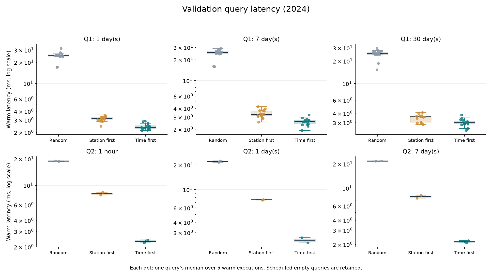
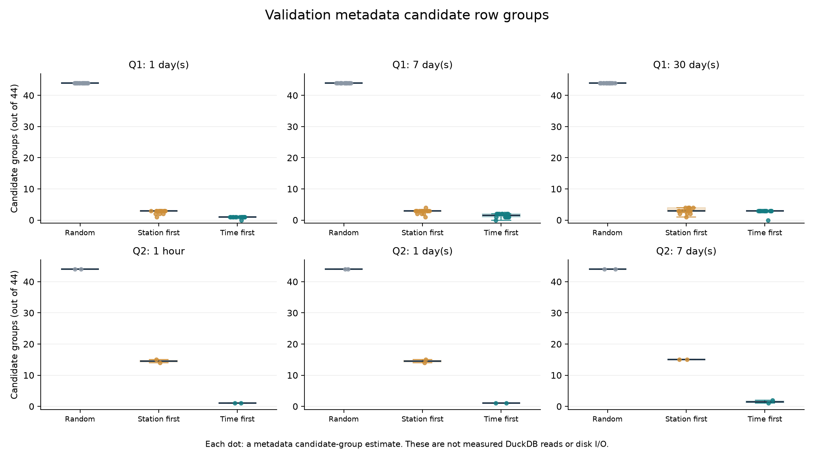
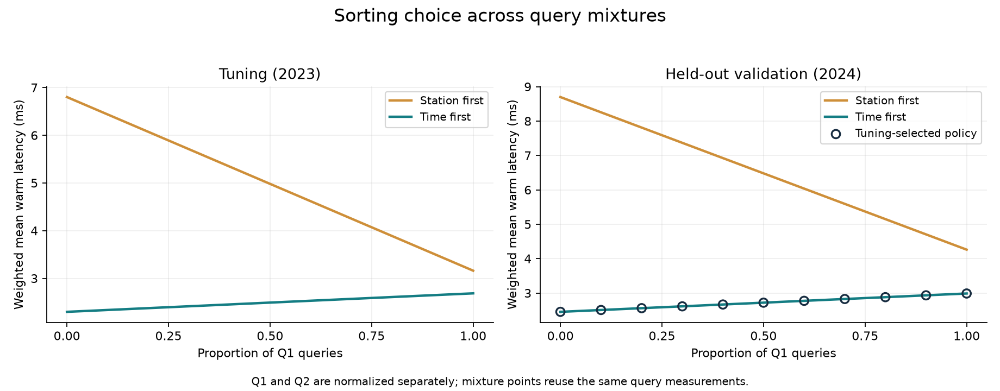
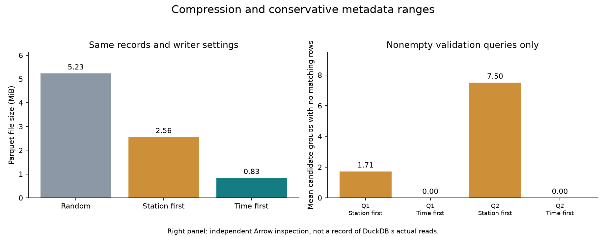

# 正式实验图表

全部图表由 code/analyze_parquet_formal.py 根据已保存的真实测量生成，提供 PNG 预览和 PDF 矢量版本。图中文字使用英文，说明对应如下：Q1 为单站点时间范围查询，Q2 为跨站点时间窗口查询。

| 图表 | 内容 | PNG | PDF |
|---|---|---|---|
| 验证集查询耗时 | 每个点为一个查询五次计时的中位数；纵轴为对数刻度，包含计划中的空查询 | [PNG](validation_latency.png) | [PDF](validation_latency.pdf) |
| 候选行组数量 | 逐列 min/max 无法排除的候选行组，不是实测 I/O | [PNG](validation_candidate_groups.png) | [PDF](validation_candidate_groups.pdf) |
| 查询比例与选择验证 | 调整集选择先冻结，再用验证集评价；各比例复用相同测量 | [PNG](selection_validation.png) | [PDF](selection_validation.pdf) |
| 文件体积与范围误保留 | 压缩后体积，以及非空验证查询中没有联合匹配行的候选组 | [PNG](layout_and_boundary.png) | [PDF](layout_and_boundary.pdf) |

